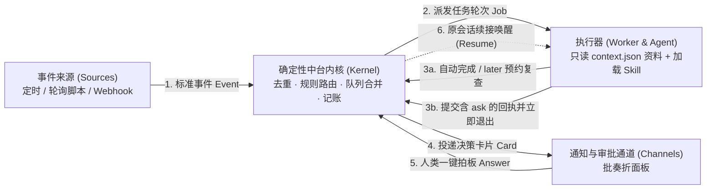

# 01. 深度研究报告：`agent-autoloop` 工作机制解析与 Antigravity 全内生化可行性论证

## 1. 研究背景与核心命题

当前主流 AI 编程与事务代理（如 Claude Code、Codex、Antigravity Chat）的默认交互范式仍是**「人守着窗口聊天」**：每一个任务的起点都是人打开对话框输入指令，人同时能盯住的活跃会话上限通常只有 3～5 个。一旦人离开屏幕或关掉窗口，多任务推进就会停摆——**单任务的上限取决于模型能力，而多任务并发的上限卡在人的注意力**。

开源项目 [KKKKhazix/agent-autoloop](https://github.com/KKKKhazix/agent-autoloop) 及其作者（数字生命卡兹克）在两篇深度长文（[《折腾了整整1年，毫无保留地分享一下我这套Agent自动化系统》](https://x.com/Khazix0918/status/2117054043868860521) 与 [《开源我这折腾了1年的「Agent自动化系统」》](https://x.com/Khazix0918/status/2117776745688646139)）中，提出了一套以**「内阁票拟 + 皇帝批红」**为核心隐喻的轻量级事件驱动自动化工作台。

本研究需要回答两个核心问题：
1. **`agent-autoloop` 的完整工作机制、核心抽象与工程精髓到底是什么？**
2. **如果完全抛弃外部云服务器、外部 IM 机器人（飞书/钉钉/Slack）以及外部 CLI Agent（Claude Code/Codex），将「事件中台 + 调度内核 + 多模型子代理工作流 + CI 审查交付 + 批奏折交互」100% 收敛到 Google Antigravity 程序内部，在技术架构上是否完全可行？如何做到最优实现？**

---

## 2. 原项目 `agent-autoloop` 工作方式与架构深度总结

通过对 `KKKKhazix/agent-autoloop` 源码（`kernel/`、`host/`、`protocol/`、`worker/`、`plugins/`）及作者设计自述的完整拆解，其工作方式可精确概括为**「一套注意力哲学、六个核心领域词、一个三口循环协议、四大确定性内核机制、四向可插拔生态」**。

### 2.1 核心工作哲学：「去人工起点」与「票拟—批红」

- **把任务起点从人身上拿掉**：用定时规则（Cron）、轻量零 Token 轮询脚本（Poller）、Webhook 或上游 Agent 衍生事件来自动触发下游工作，而非等待人类手动开窗提问。
- **默认绝对安静（注意力最贵）**：常规事务走「全自动闭环」——自己查证、自己执行、拿不到最终结果就用 `later` 预约半小时后再醒来核实，全程不发通知打扰人类。
- **关键边界才递「票拟」（`askFirst`）**：只有触及 `rules.json` 明确规定的红线（删数据、停服、花钱、对外发消息、变更权限或密钥）或遇到只有本人能解除的登录/授权阻塞时，Agent 才生成结构化问题卡片（含背景摘要、候选方案与推荐项「票拟」），由人类一键点击拍板（「批红」）。
- **定过的事绝不二问**：通过项目内沉淀 `docs/decisions.md`（已拍板决定）与 `docs/declined.md`（已否决提议），Agent 行动前先核对历史圣旨，避免重复消耗人类注意力。

### 2.2 六个核心概念与全链路闭环



| 核心概念 | 精确语义与状态职责 |
| :--- | :--- |
| **事件（Event）** | 标准化的输入信号：`{ id, source, type, subject, summary, detail, link, hops }`。定时触发、人工点选卡片、到期复查，在内核眼中全都是同构事件。按 `source + id` 严格幂等去重。 |
| **规则（Rule）** | 声明式路由表（`rules.json`）：规定「什么事件（`when`）→ 交给哪个 Agent/模型（`to`）→ 在哪个目录（`cwd`）→ 按哪份 SOP 手册（`skill`/`prompt`）→ 并发上限多少（`group`/`parallel`/`maxActive`）→ 是否续接旧会话（`resume`）」。 |
| **事项（Lane / Thread）** | 同一条规则下针对同一业务对象（`rule + subject`）的持续生命周期。当一轮正在运行时，该事项新涌入的多条事件会自动在队列中**合并为一轮**处理，防止多个 Agent 同时修改同一对象引发竞态。 |
| **一轮（Run）** | 事项的一次具体执行过程（`queued → claimed → done / nothing / failed / cancelled / unknown`）。一轮做完即销毁进程，事项本身则通过卡片或复查定时器继续存续。 |
| **回执（Receipt）** | Agent 最后一条回复末尾附带的 ```` ```agent-autoloop ```` JSON 代码块，包含五种原语：`ask`（提问卡片）、`notice`（通知/FYI）、`resolve`（核实结案）、`later`（预约复查/取消复查）、`events`（触发下游事件）。整个回执在单事务内原子生效；若 JSON 语法写错，仅在原会话请求重写最后一条消息（最多 2 次），**绝不重做已执行的业务操作**。 |
| **卡片（Card）** | 面向人类的交互单元。提问卡走 `open → decided → done`（或 `closed`），保证同一张卡片只能被有效回答一次，且续办成功后自动在卡面回写最终执行结论。 |

### 2.3 内核的四大计算机工程机制

1. **挂起零消耗（Zero-Cost Suspend）**：借鉴长周期审批流引擎的「存档—读档」设计。Agent 发出 `ask` 卡片后进程直接退出，哪怕用户三天不批复，期间也**零 Agent 进程驻留、零轮询、零 Token 消耗**；所有挂起上下文与原 `session` 编号持久化在本地 SQLite 中，用户点击后精准接回原会话继续。
2. **事件溯源与崩溃不丢账（Event Sourcing on SQLite WAL）**：~1,650 行纯函数内核 `decide(view, input, now, env)` 不读时钟、不取随机数、不联网。所有决策先生成不可变 `Fact` 追加进日志，并在同一 SQLite `WAL + FULL` 事务中更新 `projections` 与 `due` 时钟表。支持 `why <run>` 一键回溯任意轮次的规则版本、触发事件、执行者与回执全链路。
3. **指令数据分离（Instruction-Data Separation）**：借鉴 SQL 参数化预编译防注入思想。外部不可信文本（如他人提交的 Issue 正文、报错堆栈）一律写入外部 `context.json` 并标记为纯参考资料，绝不拼入命令提示词；执行模型、工作目录、权限级别完全由本机可信 `rules.json` 锁定。
4. **跳数熔断（TTL / Hop Circuit Breaker）**：借鉴 IP 数据包 TTL 机制。Agent 回执发出的衍生事件逐跳累加 `hops`（跨越人工提问与定时复查亦不清零），一旦超过 `MAX_HOPS = 8` 立即停止派单并推送熔断告警卡片，彻底杜绝多 Agent 互相唤醒死循环烧光额度。

### 2.4 本地 CI 交付与异构模型审查流水线

作者将高频代码交付抽象为五步标准状态机：**异构审查（Review）→ 自动化检查（Check）→ 自动合并（Merge）→ 发布触发（Ship）→ 线上版本核实（Verify Live）**：
- **读写分离与异构互审**：写代码的模型不能自己审自己；审查模型运行在**只读、无网、无记忆污染**的隔离沙箱中，仅针对 Git 裸对象生成的 diff 快照找「真会出错的 Bug」，且同一提交不重复审、总往返上限卡死（≤3 轮）。
- **配置只信主干（Trusted Main Only）**：审查策略与交付配置只从主干分支读取，绝不在宿主环境直接检出运行不可信分支里的钩子或脚本。

---

## 3. 全量迁移至 Antigravity 内部的深度可行性分析

### 3.1 总体结论

**完全可行，且 Antigravity 的底层原生架构几乎像是为内生版 Autoloop 量身定制的宿主操作系统。**

通过对当前 Antigravity 运行环境的实机探查，我们确认以下核心底座均已内置就绪：
- **内置运行时**：本机 Node.js `v24.19.0`（原生内置 `node:sqlite` 的 `DatabaseSync`、原生支持 `.ts` 类型擦除直跑），完全满足「零第三方 npm 运行时依赖」。
- **内置常驻守护与辅助面板框架（`sidecar_sdk`）**：位于 `~/.gemini/antigravity/lib/node_modules/sidecar_sdk`，原生提供 `SidecarApp`（自动绑定 `127.0.0.1:${ANTIGRAVITY_SIDECAR_WEB_PORT}`、自带 `ANTIGRAVITY_SIDECAR_UI_TOKEN` 鉴权、支持 `restart_policy: "always"` 随 Antigravity 自动拉起保活，并支持将 Web UI 挂载至右侧辅助面板 `SIDECAR_UI_ENTRYPOINT_AUX_PANE`）。
- **内置双模 Agent 驱动接口（`agy` CLI 与 `agentapi`）**：
  - `agy -p`（Headless Print 模式）：原生支持 `--conversation <id>` 跨进程精准续接会话、`--model <model_id>` 指定任意内部模型、`--effort <low|medium|high|xhigh|max>` 控制推理深度、`--mode <plan|accept-edits|auto>` 与 `--sandbox` 映射权限档位、`--output-format stream-json` 提取会话 ID 与用量统计，且执行完一轮立即退出进程！
  - `agentapi`（UI 会话桥接）：原生支持 `new-conversation` 创建可见对话、`send-message <recipient_id>` 唤醒指定会话、`get-conversation-metadata` 查询状态，且 `SidecarApp` 已将其封装为内置实例方法。
- **内置全谱系模型池（无需外部订阅拼凑）**：实机已验证可直接调度的内部模型包括 `gemini-4-carbon-{low,medium,high}`、`gemini-4-argon-{low,medium,high}`、`gemini-4-hydrogen-{low,medium,high,xhigh}`、`gemini-3.8-flash-{low,medium,high}`、`claude-opus-5-5-{low,medium,high}`、`claude-sonnet-5-5-{low,medium,high}` 等，完美支撑「主力开发 + 高性价比运维 + 深度只读审查」的异构分工。
- **内置插件化扩展四件套**：`plugin.json` 可一次性打包 `sidecars/`、`mcp_config.json`、`hooks.json`、`skills/`、`rules/AGENTS.md`。

### 3.2 原架构 vs Antigravity 全内生架构 1:1 映射表

| 原 `agent-autoloop` 模块 | 原外部实现方式 | Antigravity 全内生实现方案 | 可行性与收益评估 |
| :--- | :--- | :--- | :--- |
| **中台守护进程 (`host/up.ts`)** | OS 级 `launchd` / `systemd` 服务，监听本地端口 | **Antigravity Plugin Sidecar (`sidecars/hub/`)**：`restart_policy: "always"`，由 Antigravity Language Server 自动托管生命周期，数据存于 `PLUGIN_DATA` | **100% 原生替代**，免装系统服务，随应用自启 |
| **确定性状态内核 (`kernel/`)** | Node 24 + `node:sqlite` WAL 单事务事件溯源 | **原汁原味保留并增强确定性内核**：复用 Node 24 `node:sqlite` + 纯函数 `decide/evolve/store` | **100% 完美兼容**，保留 `<2ms` 派单与崩溃零丢账 |
| **Agent 接单执行 (`worker/` + Claude/Codex)** | 子进程调用外部 `claude` / `codex` CLI | **双引擎原生执行器 (`engine/`)**：<br/>1. 主力无头引擎：`agy -p --output-format stream-json --conversation <id> --model <id> --effort <lvl> --mode <m> --sandbox`<br/>2. 交互/浏览器引擎：`agentapi new-conversation` / `send-message`（联动内置 `browser` 子代理）<br/>3. 零 Token 探针：`command` 本地脚本 | **100% 内生闭环**，真正实现「一轮结束即退进程、挂起零消耗、点卡精准接回原会话」 |
| **「批奏折」通道 (`plugins/feishu` 等)** | 飞书企业机器人长连接 / 钉钉企微 Webhook + 公网 URL | **三位一体原生交互面**：<br/>1. **主阵地**：右侧辅助面板 `Autoloop 批奏折工作台`（`SIDECAR_UI_ENTRYPOINT_AUX_PANE`），支持票拟高亮、一键批红、自由批注、流水线可视化与 `why` 溯源<br/>2. **对话内操控**：`autoloop-mcp` 工具集，任意聊天窗直接查状态、批卡片<br/>3. **后台提醒**：macOS 原生桌面通知唤醒 | **体验大幅超越原版**，零外部账号配置、零公网暴露，开箱即用 |
| **高危动作拦截 (`askFirst`)** | 仅写入 Prompt 软性叮嘱 Agent 先发 `ask` | **Prompt 约定 + `hooks.json` (`PreToolUse`) 硬门禁双保险**：当环境变量带有 `AUTOLOOP_RUN_ID` 时，`PreToolUse` 自动核验命令/写路径是否触碰未获批的 `askFirst` 策略，违规直接 `deny` 并引导输出 `ask` 回执 | **安全性质的飞跃**，从「君子协定」升级为「内核级硬拦截」 |
| **回执语法纠错 (`repairPrompt`)** | 外部重新拉起一次 CLI 续接会话重写回执 | **`hooks.json` (`Stop`) 原地拦截纠错 + Worker 兜底重写**：在 Agent 准备结束回合时，`Stop` 钩子实时检查末尾代码块语法，有误直接返回 `{"decision":"continue","reason":"..."}` 让模型当场修正，省去二次冷启动开销 | **延迟与 Token 双降** |
| **事件来源 (`plugins/github` 等)** | 公网 Webhook 推送 + 定时 + 本地轮询脚本 | **全本地事件源矩阵**：<br/>1. 内核毫秒级 `Cron` 调度器（支持合盖唤醒补跑最近一次）<br/>2. `fs.watch` 本地工作区/收件箱目录文件变更监听<br/>3. `command` 零 Token 探针脚本（如 `git fetch` 分支对比、`gh` 状态轮询、本地端口健康检查）<br/>4. 对话内 `autoloop_emit` 手动/子代理派单 | **95% 场景无缝覆盖**（见 3.3 边界说明） |
| **CI 审查交付流水线 (`plugins/delivery`)** | 独立 Mac Mini 轮询 GitHub PR 标签 + Codex 审 Claude | **内生本地工作树交付流水线 (`delivery/`)**：基于 `git worktree` 隔离检出 + 异构模型（如 `gemini-4-hydrogen-xhigh` `--mode plan --sandbox`）只读快照审查（≤3 轮、绑定提交 SHA）+ 本地自动化测试门禁 + 自动合并/可选 `gh` PR 同步 | **完全脱离外部 CI 额度限制**，单机即可跑通「开发 → 异构审查 → 测试 → 合并」闭环 |
| **长期记忆与圣旨沉淀 (`decisions.md`)** | 仓库内静态 Markdown 文件 | **双层决策记忆**：工作区内 `.autoloop/decisions.md` & `declined.md`（确定性可读）+ 可选联动已安装的 `OpenViking` 语义经验库 | **原生兼容且支持跨项目沉淀** |

---

## 3.3 客观边界约束与工程化解方案（防踩坑评估）

在「100% 不借助外部力量」的前提下，有 **3 项物理与平台级客观边界**必须在架构设计阶段正面解决：

### 约束一：宿主生命周期耦合（应用退出即休眠）
- **现象**：由于不注册独立于 Antigravity 之外的云端服务器或系统级 Root 守护进程，当用户彻底退出（Cmd+Q）Antigravity 主程序时，其托管的 Sidecar 也会随之停止。
- **工程解法**：
  1. 在文档与初始化向导中引导开启 Antigravity 2.0 设置中的 **`Run in background`（后台驻留）**。
  2. 内核完整保留 `cron` 的 **`latestBefore` 唤醒补跑机制**与 `worker` 的 **进程组恢复对账机制**：即便笔记本合盖休眠数小时或重启了 Antigravity，Sidecar 启动后会在毫秒级内扫描错过的定时计划（每条规则只安全补跑最近一次，绝不雪崩积压），并将中断前未完结的轮次安全恢复。

### 约束二：无公网入站端口下的外部事件接入与手机远程审批
- **现象**：纯内生模式下只绑定 `127.0.0.1`，不开放任何公网端口，外部 SaaS 无法直接打入 HTTP Webhook，人在户外用手机也无法直接点电脑屏幕上的辅助面板。
- **工程解法**：
  1. **用「零 Token 本地探针（Pull）」替代「公网 Webhook（Push）」**：通过 `use: "command"` 运行轻量本地探测脚本（耗时几十毫秒、无变化退出码 0 且不产生事件、不唤醒大模型、零 Token 消耗），体验上与近实时推送几乎无异，且无需保管 Webhook 验签公网暴露面。
  2. **协议层保留标准扩展槽**：内核与 Sidecar 仍采用标准请求结构，未来用户若自行开启内网穿透或挂载可选通道脚本，无需改动内核一行代码。

### 约束三：Antigravity 多子代理工具对 `Hydrogen` 模型指定的机制差异（关键实操发现）
- **实机验证发现**：
  - Antigravity 的普通 `invoke_subagent` 工具其 `Model` 枚举仅支持 `"inherit" | "flash_lite" | "flash" | "pro"`，若主对话运行在 `Carbon` 模型上，直接调 `invoke_subagent` 无法显式钉死 `"gemini-4-hydrogen-high"`。
  - **但 Antigravity 原生的 `swarm` 工具（Native Swarm）以及 `agy -p` / `agentapi` 均原生支持按精确模型 ID 钉死模型！** 实机 `agy models` 已确认存在四个 Hydrogen 档位：
    - `gemini-4-hydrogen-xhigh`（`Gemini 4 Hydrogen (XHigh)`）
    - `gemini-4-hydrogen-high`（`Gemini 4 Hydrogen (High)`）
    - `gemini-4-hydrogen-medium`（`Gemini 4 Hydrogen (Medium)`）
    - `gemini-4-hydrogen-low`（`Gemini 4 Hydrogen (Low)`）
- **工程解法**：
  1. **研发期（构建本项目时）**：使用 Antigravity 原生 **`swarm` 协作集群**（`swarm{action: "add", name: "<role>", model: "gemini-4-hydrogen-high", workspace: "share", brief: "..."}`），既能将每个开发子代理精准钉死在 `Hydrogen` 模型上，又能通过 `workspace: "share"` 为每个子代理分配独立工作树，彻底避免多代理并发改文件冲突！
  2. **运行期（本项目建成工作后）**：`engine/agy-runner.ts` 直接通过 `agy -p --model gemini-4-hydrogen-high ...` 按每条 `rules.json` 配置精确调度任意 Hydrogen / Carbon / Opus / Flash 模型。

---

## 4. 可行性评估总结

| 评估维度 | 结论 | 风险等级 | 核心依据 |
| :--- | :--- | :--- | :--- |
| **技术完备性** | **完全可行** | 低 | `node:sqlite`、`SidecarApp`、`agy -p --conversation`、`hooks.json`、`mcp_config.json` 均已在本机实测验证 |
| **零消耗挂起能力** | **完全可行** | 低 | `agy -p` 单轮退出释放全部内存与上下文，SQLite 持久化 `conversationId`，点卡后无缝续接 |
| **安全性与可控性** | **优于原版** | 低 | 指令数据物理隔离 + 8 跳熔断 + `PreToolUse` 硬拦截 + `127.0.0.1` UI Token 鉴权 |
| **并行研发可拆分性** | **极高** | 低 | 严格分层为 `protocol` / `kernel` / `engine` / `delivery` / `mcp` / `hooks` / `sidecar+ui` / `sim`，模块间仅靠冻结 JSON/TS 契约通信 |
