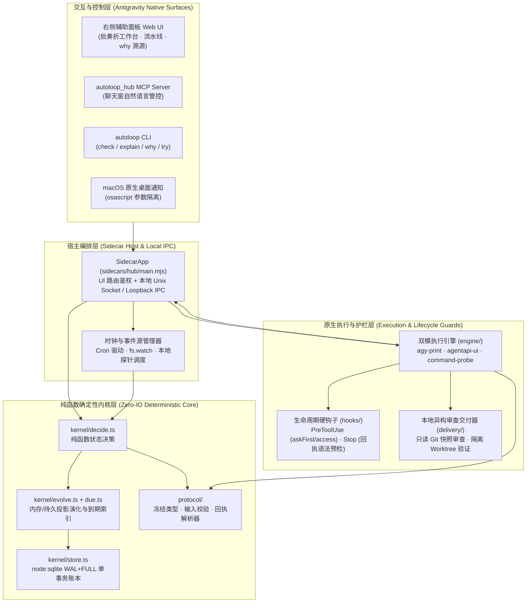

# 03. 系统架构设计与内部通信协议规范（Architecture & Frozen Contracts）

> **重要说明**：本文档定义所有模块之间的**冻结契约（Frozen Contracts）**。多个 Hydrogen 子代理并行开发时，严禁私自修改本规范中的数据结构、枚举名称、环境变量名、SQLite 表名及 IPC/HTTP 路由签名。

---

## 1. 总体分层架构

系统严格划分为 **五层解耦架构**，依赖方向只能**由外向内单向指向 `protocol/` 与 `kernel/`**：



---

## 2. Antigravity 插件包物理目录与职责清单

整个仓库本身即符合 Antigravity 原生插件规范（可软链至 `~/.gemini/config/plugins/autoloop`）：

```text
Antigravity-autoloop/
├── plugin.json                        # 插件清单 (name: "autoloop", displayName: "Autoloop 工作台")
├── mcp_config.json                    # 注册 stdio MCP: autoloop_hub
├── hooks.json                         # 注册 PreToolUse 与 Stop 钩子
├── sidecars.json                      # 指向 sidecars/hub 目录（若采用外部引用）或直接置于 sidecars/hub/sidecar.json
├── rules/
│   └── AGENTS.md                      # 插件启用时注入的精简协同说明（< 4KB）
├── protocol/                          # [零依赖契约层]
│   ├── types.ts                       # 所有跨模块共享 TypeScript 接口与字面量枚举
│   ├── validate.ts                    # 输入边界校验（字符集白名单、长度上限、Hops 校验）
│   ├── receipt.ts                     # promptFor() 构造器、readMessage() 回执解析与 repairPrompt()
│   └── rules-schema.ts                # rules.json 解析、默认值补齐与离线静态检查
├── kernel/                            # [确定性纯内核层]
│   ├── errors.ts                      # AuthError / ConflictError / InputError / NotFoundError
│   ├── cron.ts                        # 5 段 Cron 解析、IANA 时区换算、latestBefore 与 nextRun
│   ├── due.ts                         # 复查到期、重发退避、租约超时、暂停自动恢复截止时间计算
│   ├── evolve.ts                      # Fact / Change / View 内存投影与状态快照克隆
│   ├── query.ts                       # 规则路由匹配、并发槽位计算、卡片视图与因果链查询
│   ├── decide.ts                      # 唯一状态转移入口 decide(view, input, now, env)
│   └── store.ts                       # node:sqlite DatabaseSync 封装（facts + projections 单事务提交与指纹重建）
├── engine/                            # [Antigravity 原生执行层]
│   ├── context-file.ts                # 生成每轮隔离的 context.json 与运行时元数据文件（0600 权限）
│   ├── agy-runner.ts                  # 调用 `agy -p --output-format stream-json --conversation ...`
│   ├── agentapi-runner.ts             # 调用 `agentapi new-conversation / send-message` + transcript 监听
│   ├── command-runner.ts              # 零 Token 本地脚本执行器（execFile 参数数组隔离）
│   └── supervisor.ts                  # Worker 领单循环、心跳续租、进程组优雅/强制停止、回执二次修复编排
├── hooks/                             # [Antigravity 生命周期硬护栏]
│   ├── pre-tool-guard.mjs             # PreToolUse 入口：拦截违反 access 或未获批 askFirst 的工具调用
│   └── stop-receipt-check.mjs         # Stop 入口：检测残缺/非法 agent-autoloop 代码块并要求当场重写
├── delivery/                          # [本地异构审查与自动交付层]
│   ├── snapshot.ts                    # 从裸 Git 对象提取只读 diff 快照（不检出不可信分支钩子）
│   ├── reviewer.ts                    # 调度异构模型（如 Hydrogen XHigh）执行只读审查（≤3 轮、绑定 SHA）
│   └── pipeline.ts                    # Review -> Worktree Check -> Merge -> Verify 状态机驱动
├── sidecars/
│   └── hub/                           # [常驻宿主与辅助面板 Web UI]
│       ├── sidecar.json               # Sidecar 声明（AUX_PANE 挂载、restart_policy: "always"）
│       ├── main.mjs                   # SidecarApp + 本地 IPC Server + 内核/执行器装配启动器
│       ├── ipc-server.ts              # 供本机 MCP / CLI / Supervisor 通信的本地鉴权 HTTP/Unix Socket 服务
│       ├── file-watcher.ts            # 本地目录监听事件源（防抖 + 稳定幂等 ID）
│       ├── notifier.ts                # macOS osascript 通知器
│       └── web/                       # 右侧辅助面板前端（index.html, styles.css, app.js）
├── mcp/
│   └── server.mjs                     # Stdio JSON-RPC 2.0 MCP 服务端（暴露 autoloop_* 工具）
├── cli/
│   └── main.ts                        # 本地诊断 CLI（status / why / check / explain / emit / try）
├── skills/                            # [内置管理手册与五大场景 SOP]
├── tests/                             # [单元、纯洁性与桩集成测试]
└── sim/                               # [20 万步确定性随机模拟与强杀崩溃恢复测试]
```

---

## 3. 核心数据存储与目录规范

所有运行态数据默认存放于插件持久化数据目录 `AUTOLOOP_HOME`（优先级：环境变量 `AUTOLOOP_HOME` > `${PLUGIN_DATA}` > `~/.gemini/antigravity/autoloop_data`，目录权限强制 `0700`，敏感文件强制 `0600`）：

```text
<AUTOLOOP_HOME>/
├── hub.db                 # SQLite WAL 数据库（含 facts 只追加日志表与 projections 物化投影表）
├── master.key             # 32 字节随机主密钥（0600），用于签发单轮次执行 token 与本地 IPC 鉴权
├── ipc.json               # 当前运行中的本地 IPC 地址与端口发现文件（0600）
├── rules.json             # 用户声明式路由与自动化规则配置
└── runs/
    └── <runId>-<attempt>/
        ├── context.json   # 本轮只读参考资料（events / answers / timers / waiting / open / decided）
        ├── guard.json     # 供 PreToolUse 钩子读取的本轮权限快照（access / cwd / askFirst / approvedKeys）
        └── output.log     # 原始流输出留存（保留 14 天自动清理）
```

---

## 4. 冻结核心数据契约（`protocol/types.ts`）

### 4.1 标准事件（`AutoloopEvent`）

```ts
export interface InboundEvent {
  /** 来源内幂等唯一键，最长 200 字符 */
  id: string;
  /** 事件类型（仅允许 [a-zA-Z0-9._-]，最长 64 字符），如 "git.branch.ready"、"cron.due" */
  type: string;
  /** 业务事项标识（仅允许 [a-zA-Z0-9#._:/@-]，最长 100 字符），会进入安全提示词头部 */
  subject?: string;
  /** 一句话摘要（最长 200 字符），仅写入 context.json，严禁拼入提示词 */
  summary?: string;
  /** 详细负载文本（最长 8000 字符），仅写入 context.json，严禁拼入提示词 */
  detail?: string;
  /** 纯 ASCII http/https/file 链接（最长 500 字符） */
  link?: string;
  /** 事件传递跳数，外部源默认为 0，回执衍生自动 +1，超过 8 触发熔断 */
  hops?: number;
}
```

### 4.2 规则配置契约（`RulesConfig`）

```ts
export type AccessTier = "read" | "edit" | "full";
export type RunnerKind = "agy-print" | "agentapi-ui" | "command" | "delivery";
export type TellPolicy = "always" | "needed" | "never";

export interface AgentProfile {
  name: string;
  runner: RunnerKind;
  /** Antigravity 内部模型 ID，例如 "gemini-4-hydrogen-high"、"gemini-4-carbon-high" */
  model?: string;
  effort?: "low" | "medium" | "high" | "xhigh" | "max";
  access?: AccessTier;
  /** runner === "command" 时的可执行参数数组，如 ["node", "./probes/check.mjs"] */
  command?: string[];
  /** 跨所有规则最大同时运行轮数 */
  maxActive?: number;
  /** 单轮超时分钟数，默认 60 */
  timeoutMinutes?: number;
}

export interface RuleSpec {
  name: string;
  when:
    | { cron: string }
    | { source: string; types: string[] }
    | { watch: { paths: string[]; debounceMs?: number; types?: string[] } };
  /** 对应 agents 中的键名 */
  to: string;
  /** 任务执行的工作区绝对路径或 ~/ 路径 */
  cwd: string;
  /** 要加载的 Skill 名称 */
  skill?: string;
  /** 补充任务指令（可信来源） */
  prompt?: string;
  /** 会话标题模板，仅允许首字符字母数字的无空白标识符，支持 {subject} 与 {id} */
  title?: string;
  /** 并发控制组名，默认等于规则 name */
  group?: string;
  /** 存在时按 subject 切分独立事项（Lane），并指定同组最大并发轮数 */
  parallel?: number;
  /** 单条规则最大同时运行轮数 */
  maxActive?: number;
  /** 同事项新事件是否默认续接上一轮成功会话 */
  resume?: boolean;
  /** 通知策略，默认 "needed" */
  tell?: TellPolicy;
  /** 允许回执发出的衍生事件白名单 */
  emits?: { source: string; types: string[] };
}

export interface RulesConfig {
  timezone?: string;
  /** 全局必须先上呈「票拟」卡片获批的动作类别与命令模式 */
  askFirst: string[];
  sources: Record<string, { name: string }>;
  agents: Record<string, AgentProfile>;
  rules: RuleSpec[];
}
```

### 4.3 派单任务包（`Job`）与原子回执（`Receipt` & `RunResult`）

```ts
export interface Job {
  run: number;
  /** 单轮单次执行专属 HMAC Token */
  token: string;
  attempt: number;
  rule: Pick<RuleSpec, "name" | "cwd" | "skill" | "prompt" | "title" | "emits">;
  agent: AgentProfile & { id: string };
  /** 期望续接的 Antigravity conversationId（无法续接时安全降级开新会话） */
  session: string | null;
  askFirst: string[];
  context: {
    events: Array<InboundEvent & { source: string; sourceName: string; receivedAt: string }>;
    answers: Array<{
      card: number;
      key: string;
      title: string;
      options: string[];
      choice: number | null;
      chosen: string;
      about: string;
      at: string;
    }>;
    timers: Array<{ key: string; about: string; at: string }>;
    waiting: Array<{ key: string; about: string; at: string }>;
    open: Array<{ card: number; key: string; title: string; text: string; at: string }>;
    decided: Array<{ card: number; key: string; title: string; choice: string; at: string }>;
  };
}

export interface Receipt {
  ask?: Array<{
    key: string;
    title: string;
    text: string;
    options: string[];
    recommend?: number;
    about: string;
  }>;
  notice?: Array<{
    key?: string;
    title: string;
    text: string;
    fyi?: boolean;
  }>;
  resolve?: Array<{
    card: number;
    reason: string;
  }>;
  later?: Array<
    | { key: string; at: string; about: string; cancel?: false }
    | { key: string; cancel: true }
  >;
  events?: InboundEvent[];
}

export interface RunResult extends Receipt {
  outcome: "done" | "nothing" | "failed" | "cancelled";
  summary?: string;
  error?: string;
  /** 本轮实际使用的 Antigravity conversationId */
  session?: string;
  usage?: {
    input?: number;
    output?: number;
    cached?: number;
    cost?: number;
  };
}
```

---

## 5. 内核状态机与不变量（State Machines & Invariants）

### 5.1 轮次（`runs`）状态流转
- `queued` → `claimed`（Worker 领取并生成专属 `token`，锁定规则与模型快照）
- `claimed` → `done` | `nothing` | `cancelled`（终态不可逆）
- `claimed` → `unknown`（超过 5 分钟无心跳；释放组并发名额，但锁定其曾打开的 `session` 禁止新轮次同时打开；迟到结果仍可正常提交）
- `claimed` / `unknown` → `queued`（提交 `failed` 且未处于 `cancel_at` 停止态，且 `attempts < 10`；退避 `not_before` 并将同事项排队事件合并入本轮）
- **铁律**：当用户点击 `stop`（记录 `cancel_at`）后，即使子进程退出上报 `failed`，内核也必须强制归入 `cancelled`，绝不重排重试。

### 5.2 决策卡片（`cards`）状态流转
- **提问卡（`kind: "ask"`）**：
  - `open` → `decided`（用户在面板或 MCP 提交回答，原子生成一条 `answer_event` 入队唤醒原事项）
  - `decided` → `done`（续办轮次成功执行完毕提交 `done` 回执）
  - `open` → `closed`（本人或同组授权回执调用 `resolve` 核实已无需决定）
- **通知卡（`kind: "notice"`）**：
  - `fyi: true` 创建即 `closed`（仅展示不阻塞、不进后续 `open` 列表）；
  - 普通通知创建为 `open`，点击「已阅结案」或回执 `resolve` 后转 `closed`。
- **幂等约束**：同一事项下相同 `key` 若已有 `open` 卡片，重复 `ask` 不再新建第二张卡片。

---

## 6. Antigravity 原生执行器与生命周期钩子契约

### 6.1 `agy-print` 执行器环境变量与命令行映射
启动子进程时，`engine/agy-runner.ts` 必须执行以下环境隔离与参数装配：
1. **剥离管理凭据**：从子进程 `env` 中剔除 `AUTOLOOP_OWNER_TOKEN`、`ANTIGRAVITY_SIDECAR_UI_TOKEN`，防止被调度的业务 Agent 越权调用本人接口回答自己的卡片。
2. **注入运行护栏上下文**：
   - `AUTOLOOP_RUN_ID="<run>"`
   - `AUTOLOOP_GUARD_FILE="<AUTOLOOP_HOME>/runs/<run>-<attempt>/guard.json"`
3. **构造 `agy` 命令参数数组**（使用 `spawn("agy", args, { cwd, detached: true })`，严禁 `shell: true`）：
   - 基础参数：`["--print", "--output-format", "stream-json"]`
   - 模型与推理深度：若配置了 `model` 加 `["--model", agent.model]`；若配置了 `effort` 加 `["--effort", agent.effort]`
   - 续接原会话：若 `job.session` 非空，加 `["--conversation", job.session]`
   - 权限档位映射：
     - `access === "read"` → `["--mode", "plan", "--sandbox"]`
     - `access === "edit"`（默认）→ `["--mode", "accept-edits", "--sandbox"]`
     - `access === "full"` → `["--mode", "auto"]`
   - 末尾传入由 `promptFor(job, contextFilePath)` 生成的提示词参数。

### 6.2 `hooks.json` 两个核心生命周期钩子契约
1. **`PreToolUse`（`hooks/pre-tool-guard.mjs`）**：
   - 当检测到 `process.env.AUTOLOOP_GUARD_FILE` 存在时激活（普通日常聊天会话无此变量，0 干扰直接放行 `"allow"`）。
   - 读取 `guard.json` 中的 `{ access, cwd, askFirstPatterns, approvedKeys }`：
     - 若 `access === "read"` 且工具为 `write_file` / `edit_file`，直接返回 `{"decision":"deny","reason":"当前 Autoloop 规则为只读模式 (access=read)，禁止修改文件。"}`。
     - 若工具为 `run_command` 且命令行命中高危特征（如 `rm -rf`、`git push --force`、`git reset --hard`、数据库删除或 `guard.json` 中未获批的 `askFirst` 动作），直接返回 `{"decision":"deny","reason":"该操作触碰 Autoloop askFirst 红线且尚未获得批奏折授权。请不要强行执行，改为在末尾输出 agent-autoloop ask 回执卡片向用户请示。"}`。
2. **`Stop`（`hooks/stop-receipt-check.mjs`）**：
   - 当检测到 `process.env.AUTOLOOP_GUARD_FILE` 存在且 `terminationReason === "NO_TOOL_CALL"` 时激活。
   - 读取 `transcriptPath` 最后一条模型回复，调用 `readMessage(content)`：若存在未闭合的 ```` ```agent-autoloop ```` 围栏或非法回执 JSON，返回 `{"decision":"continue","reason": repairPrompt(problem)}` 让模型在同一回合内立即订正（最多拦截 2 次，防死循环）。

---

## 7. 本地通信接口规范（Sidecar Web API & MCP 工具集）

### 7.1 Sidecar 辅助面板 API（供 `sidecars/hub/web/app.js` 调用，自动受 `SidecarApp` UI Token 保护）
- `GET /`：返回批奏折工作台主页面 HTML。
- `GET /api/state?etag=<etag>&before=<runId>`：返回全量/增量状态快照（`cards`、`recentCards`、`lines`、`runs`、`timers`、`pauses`、`skipped`、`spending`、`etag`）。
- `GET /api/why?run=<runId>`：返回指定轮次的完整因果链（规则版本、输入事件、领取时间、模型、Token 消耗、回执明细、关联会话 ID）。
- `POST /api/cards/answer`：`{ card: number, choice?: number, text?: string }` → 批复卡片并触发续办。
- `POST /api/cards/resolve`：`{ card: number, reason: string }` → 手动核实结案。
- `POST /api/runs/stop`：`{ run: number }` → 停止运行中或排队中的轮次。
- `POST /api/rules/pause` / `POST /api/rules/resume` / `POST /api/rules/replay` / `POST /api/rules/run`：规则运行态管控。

### 7.2 `autoloop_hub` MCP 工具集（全部以 `autoloop_` 前缀命名，防全局命名冲突）
- `autoloop_status`（只读）：查看待批奏折卡片、各流水线运行态与今日/近 7 日 Token 统计。
- `autoloop_why`（只读）：查询某一轮的完整前因后果。
- `autoloop_explain_rules`（只读）：校验并解释当前或草稿 `rules.json` 的路由与下次 Cron 触发时刻。
- `autoloop_answer`：替用户在对话内批复某张 `open` 卡片（`card` + `choice` 或 `text`）。
- `autoloop_resolve`：将某张卡片结案。
- `autoloop_emit`：向中台发送一条标准本地事件（如触发下游交付流水线）。
- `autoloop_pause` / `autoloop_resume` / `autoloop_replay` / `autoloop_run` / `autoloop_stop`：全套调度控制动作。
