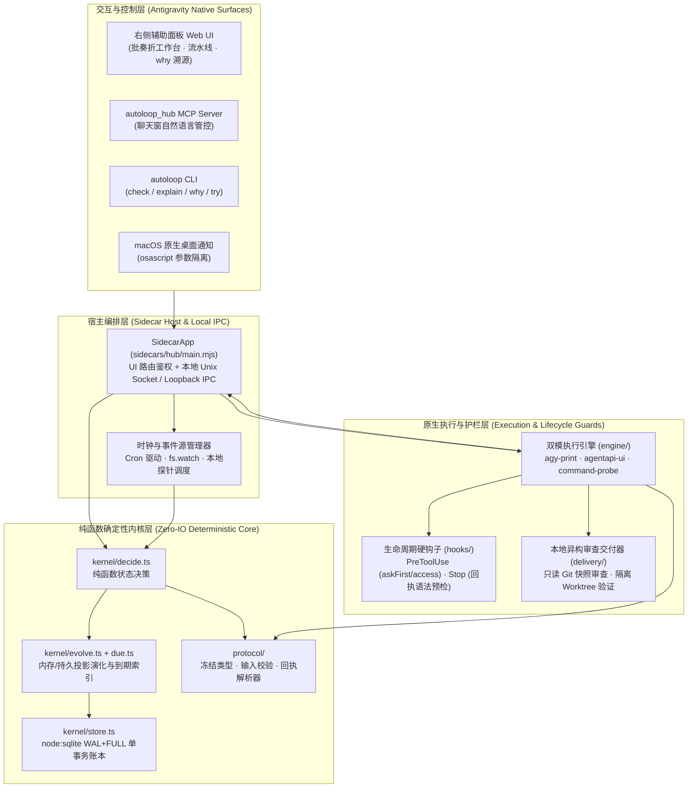

# 03. 系统架构设计与内部通信协议规范（Architecture & Frozen Contracts）

> **重要说明**：本文档定义所有模块之间的**冻结契约（Frozen Contracts）**。多个 Hydrogen 子代理并行开发时，严禁私自修改本规范中的数据结构、枚举名称、环境变量名、SQLite 表名及 IPC/HTTP 路由签名。

---

## 1. 总体分层架构

系统严格划分为 **五层解耦架构**，依赖方向只能**由外向内单向指向 `protocol/` 与 `kernel/`**：



---

## 2. Antigravity 插件包物理目录与职责清单

整个仓库本身即符合 Antigravity 原生插件规范（可软链至 `~/.gemini/config/plugins/autoloop`）：

```text
Antigravity-autoloop/
├── plugin.json                        # 插件清单 (name: "autoloop", displayName: "Autoloop 工作台")
├── mcp_config.json                    # 注册 stdio MCP: autoloop_hub
├── hooks.json                         # 注册 PreToolUse 与 Stop 钩子
├── sidecars.json                      # 指向 sidecars/hub 目录（若采用外部引用）或直接置于 sidecars/hub/sidecar.json
├── rules/
│   └── AGENTS.md                      # 插件启用时注入的精简协同说明（< 4KB）
├── protocol/                          # [零依赖契约层]
│   ├── types.ts                       # 所有跨模块共享 TypeScript 接口与字面量枚举
│   ├── validate.ts                    # 输入边界校验（字符集白名单、长度上限、Hops 校验）
│   ├── receipt.ts                     # promptFor() 构造器、readMessage() 回执解析与 repairPrompt()
│   └── rules-schema.ts                # rules.json 解析、默认值补齐与离线静态检查
├── kernel/                            # [确定性纯内核层]
│   ├── errors.ts                      # AuthError / ConflictError / InputError / NotFoundError
│   ├── cron.ts                        # 5 段 Cron 解析、IANA 时区换算、latestBefore 与 nextRun
│   ├── due.ts                         # 复查到期、重发退避、租约超时、暂停自动恢复截止时间计算
│   ├── evolve.ts                      # Fact / Change / View 内存投影与状态快照克隆
│   ├── query.ts                       # 规则路由匹配、同 (grp, lane) 并发互斥、卡片视图与因果链查询
│   ├── decide.ts                      # 唯一状态转移入口 decide(view, input, now, env)
│   └── store.ts                       # node:sqlite 单事务账本（commit / commitLatest 跨进程增量追平与指纹重建）
├── engine/                            # [Antigravity 原生执行层]
│   ├── context-file.ts                # 生成每轮隔离的 context.json 与 guard.json（0600 权限 + 否定批复防误授权限）
│   ├── agy-runner.ts                  # 调用 `agy -p --output-format stream-json --conversation ...`（含流式 result 后 30s 宽限回收）
│   ├── agentapi-runner.ts             # 调用 `agentapi new-conversation / send-message` + transcript 监听
│   ├── command-runner.ts              # 零 Token 本地脚本执行器（execFile 参数数组隔离）
│   └── supervisor.ts                  # Worker 领单、心跳续租、坏会话自动降级、回执二次修复与 discardReceipt 兜底结案
├── hooks/                             # [Antigravity 生命周期硬护栏]
│   ├── pre-tool-guard.mjs             # PreToolUse 入口：三层控制面自保护 + 子 Shell/内联脚本穿透拦截 access 与 askFirst
│   └── stop-receipt-check.mjs         # Stop 入口：检测残缺/非法 agent-autoloop 代码块并要求当场重写
├── delivery/                          # [本地异构审查与自动交付层]
│   ├── snapshot.ts                    # 从裸 Git 对象提取只读 diff.patch 与第 2 轮起 prevSha..headSha 增量补丁（纯 *.md 自动回退）
│   ├── reviewer.ts                    # 调度异构模型执行只读审查（默认 ≤2 轮、30m 超时、第 2 轮增量 Diff 定向复核、跨分支名 SHA 缓存）
│   └── pipeline.ts                    # Review -> Worktree Check -> Merge -> Verify 状态机驱动
├── sidecars/
│   └── hub/                           # [常驻宿主与辅助面板 Web UI]
│       ├── sidecar.json               # Sidecar 声明（AUX_PANE 挂载、restart_policy: "always"）
│       ├── main.mjs                   # SidecarApp + 本地 IPC Server + 内核/执行器装配启动器
│       ├── ipc-server.ts              # 供本机 MCP / CLI / Supervisor 通信的本地鉴权 HTTP/Unix Socket 服务
│       ├── file-watcher.ts            # 本地目录监听事件源（防抖 + 稳定幂等 ID）
│       ├── notifier.ts                # macOS osascript 通知器（参数隔离 + [<rule>] 来源前缀）
│       └── web/                       # 右侧辅助面板前端（index.html, styles.css, app.js）
├── mcp/
│   └── server.mjs                     # Stdio JSON-RPC 2.0 MCP 服务端（暴露 autoloop_* 工具）
├── cli/
│   └── main.ts                        # 本地诊断 CLI（status / why / check / explain / emit / try）
├── skills/                            # [内置管理手册（autoloop-admin）与七大场景 SOP（含 recipe-idea-to-sop、recipe-ai-video-studio）]
├── tests/                             # [单元、纯洁性、安全门禁与桩集成测试]
└── sim/                               # [20 万步确定性随机模拟与强杀崩溃恢复测试]
```

---

## 3. 核心数据存储与目录规范

所有运行态数据默认存放于插件持久化数据目录 `AUTOLOOP_HOME`（优先级：环境变量 `AUTOLOOP_HOME` > `${PLUGIN_DATA}` > `~/.gemini/antigravity/autoloop_data`，目录权限强制 `0700`，敏感文件强制 `0600`）：

```text
<AUTOLOOP_HOME>/
├── hub.db                 # SQLite WAL 数据库（含 facts 只追加日志表、projections 物化投影表与 store_meta）
├── master.key             # 32 字节随机主密钥（0600），用于签发单轮次执行 HMAC token
├── owner.token            # 本人管理接口凭据（0600，子进程环境强制剥离且 PreToolUse 零访问封锁）
├── ingest.token           # 本地事件投递凭据（0600，PreToolUse 零访问封锁）
├── ipc.json               # 当前运行中的本地 IPC 地址与端口发现文件（0600，PreToolUse 零访问封锁）
├── rules.json             # 用户声明式路由与自动化规则配置（PreToolUse 允许只读、严禁修改）
└── runs/
    └── <runId>-<attempt>/
        ├── context.json   # 本轮只读参考资料（events / answers / timers / waiting / open / decided）
        ├── guard.json     # 供 PreToolUse 钩子读取的本轮权限快照（0600，对业务 Agent 零访问封锁）
        └── output.log     # 原始流输出留存（保留 14 天自动清理）
```

---

## 4. 冻结核心数据契约（`protocol/types.ts`）

### 4.1 标准事件（`AutoloopEvent`）

```ts
export interface InboundEvent {
  /** 来源内幂等唯一键，最长 200 字符 */
  id: string;
  /** 事件类型（仅允许 [a-zA-Z0-9._-]，最长 64 字符），如 "git.branch.ready"、"cron.due" */
  type: string;
  /** 业务事项标识（仅允许 [a-zA-Z0-9#._:/@-]，最长 100 字符），会进入安全提示词头部 */
  subject?: string;
  /** 一句话摘要（最长 200 字符），仅写入 context.json，严禁拼入提示词 */
  summary?: string;
  /** 详细负载文本（最长 8000 字符），仅写入 context.json，严禁拼入提示词 */
  detail?: string;
  /** 纯 ASCII http:// 或 https:// 链接（最长 500 字符，严禁 file:// 或本地路径） */
  link?: string;
  /** 事件传递跳数，外部源默认为 0，回执衍生自动 +1，超过 8 触发熔断 */
  hops?: number;
}
```

### 4.2 规则配置契约（`RulesConfig`）

```ts
export type AccessTier = "read" | "edit" | "full";
export type RunnerKind = "agy-print" | "agentapi-ui" | "command" | "delivery";
export type TellPolicy = "always" | "needed" | "never";

export interface AgentProfile {
  name: string;
  runner: RunnerKind;
  /** Antigravity 内部模型 ID，例如 "gemini-4-hydrogen-high"、"gemini-4-carbon-high" */
  model?: string;
  effort?: "low" | "medium" | "high" | "xhigh" | "max";
  access?: AccessTier;
  /** runner === "command" 时的可执行参数数组，如 ["node", "./probes/check.mjs"] */
  command?: string[];
  /** 跨所有规则最大同时运行轮数 */
  maxActive?: number;
  /** 单轮超时分钟数，默认 60 */
  timeoutMinutes?: number;
}

export interface RuleSpec {
  name: string;
  when:
    | { cron: string }
    | { source: string; types: string[] }
    | { watch: { paths: string[]; debounceMs?: number; types?: string[] } };
  /** 对应 agents 中的键名 */
  to: string;
  /** 任务执行的工作区绝对路径或 ~/ 路径 */
  cwd: string;
  /** 要加载的 Skill 名称 */
  skill?: string;
  /** 补充任务指令（可信来源） */
  prompt?: string;
  /** 会话标题模板，仅允许首字符字母数字的无空白标识符，支持 {subject} 与 {id} */
  title?: string;
  /** 并发控制组名，默认等于规则 name */
  group?: string;
  /** 存在时按 subject 切分独立事项（Lane），并指定同组最大并发轮数 */
  parallel?: number;
  /** 单条规则最大同时运行轮数 */
  maxActive?: number;
  /** 同事项新事件是否默认续接上一轮成功会话 */
  resume?: boolean;
  /** 通知策略，默认 "needed" */
  tell?: TellPolicy;
  /** 允许回执发出的衍生事件白名单 */
  emits?: { source: string; types: string[] };
}

export interface RulesConfig {
  timezone?: string;
  /** 全局必须先上呈「票拟」卡片获批的动作类别与命令模式（rules.json 省略时自动填充 DEFAULT_ASK_FIRST 7 类默认红线） */
  askFirst: string[];
  sources: Record<string, { name: string }>;
  agents: Record<string, AgentProfile>;
  rules: RuleSpec[];
}
```

**规则配置静态校验与默认值契约（`protocol/rules-schema.ts` & `protocol/validate.ts`）**：
- **默认安全红线（`DEFAULT_ASK_FIRST`）**：当用户在 `rules.json` 中省略 `askFirst` 字段时，`parseRulesConfig()` 自动填充 7 类默认高危红线：`["rm -rf", "git push --force", "git reset --hard", "删除数据库", "对外发送消息", "修改密钥或权限", "产生实质费用"]`（显式传入数组时按用户配置生效）。
- **同并发组有效 `parallel` 一致性**：共享同一 `group`（`rule.group ?? rule.name`）的所有规则，其有效并发度 `rule.parallel ?? 1` 必须严格一致；若同组内两条规则出现不同有效 `parallel` 值，静态校验立即抛 `ProtocolInputError` 拒收，消除组配额歧义。
- **外部与回执链接协议收窄**：`InboundEvent.link`（含 `receipt.events[].link`）通过 `validateSafeUrl` 仅允许纯可见 ASCII 的 `http://` 或 `https://` 完整 URL（含非空主机名，最长 500 字符），一律拒收 `file://`、`javascript:` 或本地文件路径。

### 4.3 派单任务包（`Job`）与原子回执（`Receipt` & `RunResult`）

```ts
export interface Job {
  run: number;
  /** 单轮单次执行专属 HMAC Token */
  token: string;
  attempt: number;
  rule: Pick<RuleSpec, "name" | "cwd" | "skill" | "prompt" | "title" | "emits">;
  agent: AgentProfile & { id: string };
  /** 期望续接的 Antigravity conversationId（无法续接时安全降级开新会话） */
  session: string | null;
  askFirst: string[];
  context: {
    events: Array<InboundEvent & { source: string; sourceName: string; receivedAt: string }>;
    answers: Array<{
      card: number;
      key: string;
      title: string;
      options: string[];
      choice: number | null;
      chosen: string;
      about: string;
      at: string;
    }>;
    timers: Array<{ key: string; about: string; at: string }>;
    waiting: Array<{ key: string; about: string; at: string }>;
    open: Array<{ card: number; key: string; title: string; text: string; at: string }>;
    /** 同 (rule, lane) 下 status 为 "decided" | "done" 的历史已决卡片（自动排除当轮 answers 中的卡片 ID） */
    decided: Array<{ card: number; key: string; title: string; choice: string; at: string }>;
  };
}

export interface Receipt {
  ask?: Array<{
    key: string;
    title: string;
    text: string;
    options: string[];
    recommend?: number;
    about: string;
  }>;
  notice?: Array<{
    key?: string;
    title: string;
    text: string;
    fyi?: boolean;
  }>;
  resolve?: Array<{
    card: number;
    reason: string;
  }>;
  later?: Array<
    | { key: string; at: string; about: string; cancel?: false }
    | { key: string; cancel: true }
  >;
  events?: InboundEvent[];
}

export interface RunResult extends Receipt {
  outcome: "done" | "nothing" | "failed" | "cancelled";
  summary?: string;
  error?: string;
  /** 本轮实际使用的 Antigravity conversationId */
  session?: string;
  usage?: {
    input?: number;
    output?: number;
    cached?: number;
    cost?: number;
  };
}
```

**回执与首行解析契约（`protocol/receipt.ts`）**：
- **首行 Markdown 装饰符剥离（`parseFirstLine`）**：识别首行结论前自动剥离前导块级标记（`#` 标题、`>` 引用、无序/有序列表前缀）与成对行内强调符（`**`、`__`、`~~`、`*`、`_`、单反引号），确保诸如 `**没跑成**：接口超时` 或 `### NOTHING: 无需变更` 仍被精准判定为 `failed` / `nothing` 而非误判为 `done`。
- **自底向上逆向围栏扫描（`scanFencedBlocks`）**：从回复末尾向上逆向匹配闭合反引号围栏（优先精确反引号个数匹配，兼容外层 4 反引号示例），使正文中未闭合的代码块示例绝不会吞掉最末尾合法闭合的 ```` ```agent-autoloop ```` 回执，同时仍能准确捕获末尾未闭合的残缺 `agent-autoloop` 围栏并返回明确 `problem`。
- **续接会话重读最新 Skill 提醒**：当 `job.session` 非空时，`promptFor()` 自动注入续接会话提醒，强制模型重新阅读最新 `SKILL.md` 规范而非仅凭历史对话记忆行事。

---

## 5. 内核状态机、跨进程存储与不变量（State Machines, Store & Invariants）

### 5.1 单事务账本与跨进程增量同步（`kernel/store.ts`）
- **双提交原语**：除确定性批量写入 `commit(facts)` 外，`Store` 提供 `commitLatest(decideFn)`——在 `BEGIN IMMEDIATE` 排他写事务内先读取 `facts WHERE seq > view.seq` 的全部分支外部增量（如 CLI 或离线 MCP 进程直写 `hub.db` 的事实），在克隆草稿 `view.fork()` 上追平投影与高水位后再执行 `decideFn(baseView.fork())`。
- **异常回滚零内存脏写**：只有 SQLite `COMMIT` 落盘成功后才将外部增量与新 `Fact` 应用回宿主常驻内存 `view`；若事务冲突或 `decideFn` 抛错回滚（外部已有增量仍会安全同步至投影并提交），主内存 `view` 绝不残留任何未提交脏状态。`openStore` 重建 SQL 视图（`DROP VIEW` / `CREATE VIEW`）全程位于 `IMMEDIATE` 事务内，消除跨连接锁竞争。

### 5.2 轮次（`runs`）状态流转、并发互斥与退避预警
- `queued` → `claimed`（Worker 领取并生成专属 `token`，锁定规则与模型快照）：
  - `canClaimRun` 强制执行 **同 `(grp, lane)` 跨规则单活互斥**（共享同一 `group` 的不同规则在同一 `lane` 上绝不同时运行两轮），并依次校验规则未处于 `pause`、全局 Worker `capacity`、同组有效并发度 `rule.parallel ?? 1`、单规则 `maxActive` 与单 Agent `maxActive`。
- `claimed` → `done` | `nothing` | `cancelled`（终态不可逆）
- `claimed` → `unknown`（超过 5 分钟无心跳；释放组并发名额，但锁定其曾打开的 `session` 禁止新轮次同时打开；迟到结果仍可正常提交）
- `claimed` / `unknown` → `queued`（提交 `failed` 且未处于 `cancel_at` 停止态，且 `attempts < 10`）：
  - **指数退避**：默认按 `60s * 2^(attempt - 1)` 计算 `not_before`（`DEFAULT_RETRY_BASE_MS = 60_000`，单次退避上限 `30m`），并将同 `(rule, lane)` 排队期间新到达的事件与已触发定时器合并入本轮。
  - **连续失败末行预警与自愈**：当第 3 次连续失败（`attempt === 3`）进入退避重试时，自动在该 `(rule, lane)` 创建单张 `key = "sys:retry-streak-warn"` 的 `open` 通知预警卡（仅提取错误文本最后一行非空摘要并按 120 Unicode 码点安全截断，不截断代理对）；一旦该 `(rule, lane)` 后续轮次恢复成功（`done` / `nothing`），内核自动将该预警卡 `closed` 结案；连续失败满 `10` 次则转终态 `failed` 并生成 `run-failed:<runId>` 告警卡。
- **终态定时器清理**：轮次进入任意终态（`done` / `nothing` / `failed` / `cancelled`）或因规则从配置中移除而被取消时，自动清理 `timers` 表中 `fired_run === runId` 的已触发记录，防止历史定时器永久滞留内存投影。
- **铁律**：当用户点击 `stop`（记录 `cancel_at`）后，即使子进程退出上报 `failed`，内核也必须强制归入 `cancelled`，绝不重排重试。

### 5.3 决策卡片（`cards`）状态流转与通知策略
- **提问卡（`kind: "ask"`）**：
  - `open` → `decided`（用户在面板或 MCP 提交回答，原子生成一条 `answer_event` 入队唤醒原事项）
  - `decided` → `done`（续办轮次成功执行完毕提交 `done` / `nothing` 回执；`jobOf` 构造后续同 `(rule, lane)` 轮次的 `context.decided` 时同时纳入 `"decided" | "done"` 状态并剔除当轮 `context.answers` 已含卡片，确保跨轮复查与长流水线持久保留历史授权 `approvedKeys`）
  - `open` → `closed`（本人或同组授权回执调用 `resolve` 核实已无需决定）
- **通知卡（`kind: "notice"`）与 `tell: "always"` 自动简报**：
  - `fyi: true` 创建即 `closed`（仅展示不阻塞、不进后续 `open` 列表）；
  - 当规则声明 `tell: "always"` 且轮次以 `done` 完成但未显式输出任何 `ask` 或 `notice` 卡片时，内核自动生成一张 `key = "auto-fyi:<runId>"`、`fyi: true`（状态 `closed`）的执行完成简报卡；
  - `sidecars/hub/notifier.ts` 对新产生的 `open` 卡片（`tell !== "never"`）以及 `tell: "always"` 下的 `fyi` 简报卡发送桌面通知，标题统一冠以 `[<rule>]` 规则名前缀。
  - 普通通知创建为 `open`，点击「已阅结案」或回执 `resolve` 后转 `closed`。
- **幂等约束**：同一事项下相同 `key` 若已有 `open` 卡片，重复 `ask`（或非 `fyi` 同 `key` `notice`）不再新建第二张卡片。

---

## 6. Antigravity 原生执行器、安全硬钩子与增量交付契约

### 6.1 执行编排与 `agy-print` 运行契约（`engine/`）
启动业务子进程时，`engine/agy-runner.ts`（以及 `agentapi-runner.ts`、`command-runner.ts`）与 `engine/supervisor.ts` 必须执行以下隔离与容错契约：
1. **全量剥离控制面凭据**：从子进程 `env` 中剔除 `AUTOLOOP_OWNER_TOKEN`、`AUTOLOOP_INGEST_TOKEN`、`AUTOLOOP_MASTER_KEY`、`ANTIGRAVITY_SIDECAR*` 以及所有匹配 `AUTOLOOP_*_{TOKEN,SECRET,KEY,PASSWORD}` 的敏感变量，防止受控业务 Agent 越权自批卡片或篡改中台。
2. **注入运行护栏上下文**：
   - `AUTOLOOP_RUN_ID="<run>"`
   - `AUTOLOOP_CONTEXT="<AUTOLOOP_HOME>/runs/<run>-<attempt>/context.json"`
   - `AUTOLOOP_GUARD_FILE="<AUTOLOOP_HOME>/runs/<run>-<attempt>/guard.json"`
3. **构造 `agy` 命令参数数组**（使用 `spawn("agy", args, { cwd, detached: true, shell: false })`，严禁 `shell: true`）：
   - 基础参数：`["--output-format", "stream-json", ..., "--print", prompt]`
   - 模型与推理深度：若配置了 `model` 加 `["--model", agent.model]`；若配置了 `effort` 加 `["--effort", agent.effort]`
   - 续接原会话：若 `job.session` 非空，加 `["--conversation", job.session]`
   - 权限档位映射：
     - `access === "read"` → `["--mode", "plan", "--sandbox"]`
     - `access === "edit"`（默认）→ `["--mode", "accept-edits", "--sandbox"]`
     - `access === "full"` → `["--mode", "auto"]`
4. **流式 `result` 后 `30s` 退出宽限回收（`postResultGraceMs`）**：当 `agy-runner.ts` 已从 NDJSON 流收到非错误的最终 `result` 事件后，立即启动默认 `30s` 宽限计时器；若后台残留孙进程仍持有 `stdout`/`stderr` 管道未退出，宽限期满后主动向进程组发送 `SIGTERM`→`SIGKILL` 回收并按已收到的成功结果结算，防止白挂满 60 分钟造成假超时重试。
5. **坏历史会话自动降级与延迟 `session` 补报（`supervisor.ts`）**：
   - 当携带非空 `job.session` 启动但尚未收到任何启动确认帧即非零退出（`!started && !cancelled && !timedOut && exitCode !== 0`）时，自动降级清空 `session: null` 开启全新会话重跑本轮；若降级后仍未启动则绝不向内核误报空或失效会话，若降级启动成功但未返回新会话 ID 则显式提交 `session: null` 清除坏历史引用。
   - 若执行器先通过 `init`/`assistant` 事件触发 `markStarted(session: null)`，随后在后续流事件中提取到真实 `conversationId`，`supervisor.ts` 自动二次调用 `markStarted` 补报该 `session`。
6. **回执二次原地修复与 `discardReceipt` 安全降级结案（`supervisor.ts`）**：
   - 当 `exitCode === 0` 且 `parsed.problem !== null` 且存在可续接 `session` 时，最多在原会话发送 **2 次** `repairPrompt(problem)` 仅重写最后一条消息（累加各次 Token `usage`）。
   - 若首轮业务已完成（`exitCode === 0` 且首行结论为 `done` 或 `nothing`），但 2 次修复耗尽后回执仍存在格式/校验错误（或无可用 `session` 无法修复），必须执行 **`discardReceipt` 安全降级**：保留首轮 `done` / `nothing` 结论与摘要正常结案（当结论为 `done` 时自动附带一张标题为「回执格式损坏已忽略」的 `open` 告警通知卡），**严禁将其标为 `failed` 触发最多 10 次整轮重跑导致业务副作用重复执行**。

### 6.2 `hooks.json` 生命周期硬钩子与否定批复防误授权限契约
1. **`PreToolUse`（`hooks/pre-tool-guard.mjs`）**：
   - 当 `process.env.AUTOLOOP_GUARD_FILE` 未设置或文件不存在时零干扰放行 `"allow"`；一旦该变量指向的文件存在但读取/JSON 解析失败，一律按 **fail-closed** 返回 `"deny"`。
   - **三层控制面自保护**：
     - **零访问密级层**：`<AUTOLOOP_HOME>` 下的 `owner.token`、`ingest.token`、`master.key`、`ipc.json` 以及每轮的 `guard.json` 本身，禁止任何读写/搜索工具或 Shell 命令访问（防子代理偷读 Token 自批卡片或篡改自身护栏）；目录级搜索工具直接扫描 `<AUTOLOOP_HOME>` 根目录同样拒绝。
     - **数据库写禁层**：`hub.db`、`hub.db-wal`、`hub.db-shm` 禁止任何文件写删工具或命令行直接触碰（防绕过内核事务篡改事实账本）。
     - **只读控制/快照层**：`rules.json`、每轮 `context.json` 以及交付审查生成的 `diff.patch` / `incremental-diff.patch` 允许只读查看（`cat`/`head`/`rg`/`jq` 等被动只读命令与 `read_file`），严禁任何覆写、移动或删除；同时严禁修改全局 `~/.gemini/config/config.json`。
   - **穿透式只读与 `askFirst` 拦截**：自动解包 `K=V` 赋值及 `env`（含 `-S`）、`sudo`、`command`、`nohup`、`nice`、`time`、`exec` 包装参数，递归解析最多 5 层子 Shell（`sh`/`bash`/`zsh`/`dash -c`、`$()` 与反引号替换）以及内联脚本解释器（`node -e`、`python/python3 -c`、`ruby/perl -e`）：
     - 若 `access === "read"`，拒绝一切写删文件工具、写文件/改 Git 状态的 Shell 命令及内联解释器执行；
     - 若命令或删文件工具命中内置高危类别（`rm-rf`、越出 `cwd` 的递归/强制删除、`git-push-force`、`git-reset-hard`、`drop-db`）或 `guard.json` 中未获 `approvedKeys` 授权的 `askFirst` 模式，立即返回 `{"decision":"deny"}` 引导模型改发 `ask` 批奏折卡片。
2. **中英文否定批复防误授权限（`engine/context-file.ts`）**：
   - `writeRunFiles()` 从 `context.answers` 与 `context.decided` 提取 `approvedKeys` 时，`isApprovedChoice()` 先剥离无害礼貌复合词（如“不错”“不用等”“毫不犹豫”“no problem”“don't hesitate”），再对任何含中英文否定、取消、暂缓、观望词（如“不”“别”“拒绝”“算了”“暂缓”“先看日志”“no”“don't”“wait”“hold”）或以问号（`?`/`？`）结尾的自由文本批复一律判定为**未授权**（且显式拒绝会覆盖同 `key` 早期授权），严防人类回复“不要删，先看日志”被误当作 `askFirst` 放行许可。
3. **`Stop`（`hooks/stop-receipt-check.mjs`）**：
   - 当检测到 `process.env.AUTOLOOP_GUARD_FILE` 存在且 `terminationReason === "NO_TOOL_CALL"` 时激活。
   - 读取 `transcriptPath` 最后一条模型回复，调用 `readMessage(content)`：若存在未闭合的 ```` ```agent-autoloop ```` 围栏或非法回执 JSON，返回 `{"decision":"continue","reason": repairPrompt(problem)}` 让模型在同一回合内立即订正（最多拦截 2 次，防死循环）。

### 6.3 本地异构两级增量审查交付契约（`delivery/`）
1. **裸对象安全快照与增量补丁提取（`delivery/snapshot.ts`）**：
   - 始终通过 `git ls-tree` / `git show` 仅从受信任基线分支（如 `main`）读取 `.autoloop/delivery.json` 与 `AGENTS.md`（符号链接 `120000` 一律拒读），绝不检出待审分支工作树或执行不可信分支钩子；全量补丁 `diff.patch` 以 `0600` 权限原子落盘。
   - 第 2 轮起若传入上轮已审 `previousReviewedSha`，`extractIncrementalDiff()` 校验其与 `headSha` 不同、满足 `git merge-base --is-ancestor prevSha headSha` 且同属当前 `mergeBaseSha` 谱系后，生成 `prevSha..headSha` 的 `0600` 权限 `incremental-diff.patch`；若上一轮存在代码级阻塞缺陷但本轮增量仅修改了 `*.md` 文档（`docs_only`），或分支发生 rebase 改写历史（`not_ancestor` / `merge_base_drift`），自动清理增量补丁并安全回退至完整分支 `diff.patch`。
2. **异构模型路由、轮次上限与跨分支名 SHA 缓存（`delivery/reviewer.ts`）**：
   - 作者模型含 `hydrogen` 默认派给 `gemini-4-carbon-high`，含 `carbon`/`claude`/`opus`/`sonnet` 或未指定默认派给 `gemini-4-hydrogen-xhigh`（支持 `delivery.json` 的 `reviewerModels` 覆盖），以无状态 `--mode plan --sandbox`（不传 `--conversation`、临时独立 `access: "read"` `guard.json`）运行，单轮默认超时 **`30` 分钟**（`DEFAULT_REVIEW_TIMEOUT_MS`）。
   - 审查账本按 **`(headSha, mergeBaseSha, reviewerModel)`** 匹配幂等缓存（与分支名解耦，重命名分支绝不重审同一提交）；默认最大审查轮次 **`DEFAULT_MAX_REVIEW_ROUNDS = 2`**，第 2 轮仍有 `blocking` 发现或超出上限时状态置为 `escalated_to_human`，由 `pipeline.ts` 自动转为人工 `ask` 批奏折卡片。
   - **定向增量复审与防拉锯纪律**：第 2 轮起自动附带第 1 轮未决 `blockingFindings`（`file`、`line`、`title`、`detail`、`how`），要求逐条核实修复情况并检查新改动是否引入新缺陷，**严禁在未触碰的历史代码中翻找新边角问题拉锯**。
   - **两级发现与测试分节轻读**：每条 `blocking` 缺陷必须写明当前调用链下的具体触发路径（`detail` / `how`），同类成因归并为单条，`warning` / `info` 不阻断合并；普通测试文件（`tests/*.test.ts`）归入分节轻读（只查行为覆盖不挑风格），而安全与纯洁性门禁测试（`tests/purity.test.ts`、`tests/security-isolation.test.ts` 等及命中 `sensitivePaths` 的测试）维持严审防门禁弱化。

---

## 7. 本地通信接口规范（Sidecar Web API & MCP 工具集）

### 7.1 Sidecar 辅助面板 API（供 `sidecars/hub/web/app.js` 调用，自动受 `SidecarApp` UI Token 保护）
- `GET /`：返回批奏折工作台主页面 HTML。
- `GET /api/state?etag=<etag>&before=<runId>`：返回全量/增量状态快照（`cards`、`recentCards`、`lines`、`runs`、`timers`、`pauses`、`skipped`、`spending`、`etag`）。
- `GET /api/why?run=<runId>`：返回指定轮次的完整因果链（规则版本、输入事件、领取时间、模型、Token 消耗、回执明细、关联会话 ID）。
- `POST /api/cards/answer`：`{ card: number, choice?: number, text?: string }` → 批复卡片并触发续办。
- `POST /api/cards/resolve`：`{ card: number, reason: string }` → 手动核实结案。
- `POST /api/runs/stop`：`{ run: number }` → 停止运行中或排队中的轮次。
- `POST /api/rules/pause` / `POST /api/rules/resume` / `POST /api/rules/replay` / `POST /api/rules/run`：规则运行态管控。

### 7.2 `autoloop_hub` MCP 工具集（全部以 `autoloop_` 前缀命名，防全局命名冲突）
- `autoloop_status`（只读）：查看待批奏折卡片、各流水线运行态与今日/近 7 日 Token 统计。
- `autoloop_why`（只读）：查询某一轮的完整前因后果。
- `autoloop_explain_rules`（只读）：校验并解释当前或草稿 `rules.json` 的路由与下次 Cron 触发时刻。
- `autoloop_answer`：替用户在对话内批复某张 `open` 卡片（`card` + `choice` 或 `text`）。
- `autoloop_resolve`：将某张卡片结案。
- `autoloop_emit`：向中台发送一条标准本地事件（如触发下游交付流水线）。
- `autoloop_pause` / `autoloop_resume` / `autoloop_replay` / `autoloop_run` / `autoloop_stop`：全套调度控制动作。
