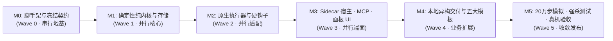

# 04. 标准研发流程、里程碑计划与版本路线图（SDLC & Roadmap）

## 1. 研发工程方法论

针对「多子代理（`Gemini 4 Hydrogen`）高并发协同开发大型系统」的特点，本项目采用 **契约冻结 → 纯核先行 → 桩件解耦 → 波次合流 → 混沌验证 → 自举狗粮（Dogfooding）** 的六步标准工程流程：

### 四条核心工程纪律
1. **契约先行（Contract-First）**：在任何业务逻辑开工前，先把 `protocol/types.ts`、`package.json`、`tsconfig.json` 与 `tests/purity.test.ts` 锁死提交到 `main`。后续所有并行子代理只导入 `protocol/`，无需互相等待实现完成。
2. **文件独占锁（Zero-Collision Ownership）**：同一波次（Wave）内同时运行的任意两个子代理，其允许修改的文件集合交集严格为空集（`Owned(A) ∩ Owned(B) = ∅`），从根源上消灭合并冲突。
3. **写审分离（Author / Verifier Split）**：每 2～4 个编码子代理（Author）配 1 个独立审查子代理（Verifier）。Author 在独立工作树（`workspace: "share"`）编写测试与实现并提交；Verifier 在只读工作区拉取差异、跑测试、对照 [AGENTS.md](../AGENTS.md) 审查清单逐条核对，通过后才由协调者（Coordinator）合入 `main`。
4. **真假分层验证（Fake-First, Live-Last）**：Wave 1～Wave 4 的自动化测试全部使用确定性内存时钟与本地 `fake-agy` 桩脚本，毫秒级跑完且不消耗大模型额度；直到 Wave 5 集成收口时再执行真机 `agy` + 右侧辅助面板端到端验收。

---

## 2. 六阶段里程碑计划（M0 ～ M5）

### 里程碑 M0：仓库地基与协议契约冻结（Wave 0）
- **目标**：建立零依赖 TypeScript + Node 24 工程底座，冻结全部跨模块接口类型、输入校验器、回执解析器与纯洁性静态门禁。
- **核心产出**：`package.json`、`tsconfig.json`、`protocol/*`、`kernel/errors.ts`、`tests/purity.test.ts`。
- **准出标准（DoD）**：
  - `npm run typecheck` 零报错；
  - `protocol/` 校验与回执解析单元测试 100% 通过；
  - `tests/purity.test.ts` 能准确检出人为注入的违规调用并恢复绿灯。

### 里程碑 M1：确定性状态机内核与 SQLite 账本（Wave 1）
- **目标**：完成不依赖任何外部环境的 `kernel/` 全套实现，跑通事件去重、规则匹配、事项合并、三级并发控制、卡片状态流转、8 跳熔断、暂停/恢复/补跑，以及 `node:sqlite` WAL 单事务持久化与指纹重放重建。
- **核心产出**：`kernel/cron.ts`、`kernel/due.ts`、`kernel/evolve.ts`、`kernel/query.ts`、`kernel/decide.ts`、`kernel/store.ts` 及对应单元测试。
- **准出标准（DoD）**：
  - 所有内核行为规格测试全绿；
  - 断库重建测试证明：删掉 `projections` 表内容或改变格式指纹后，重新打开 `hub.db` 能从 `facts` 100% 无损还原完全一致的视图与高水位编号；
  - `tests/purity.test.ts` 持续全绿。

### 里程碑 M2：Antigravity 原生执行引擎与安全钩子（Wave 2）
- **目标**：打通内核与 Antigravity 运行时的连接桥梁，完成 `context.json` 指令数据分离封装、`agy -p` 无头会话续接执行器、`agentapi` UI 唤醒执行器、零 Token 脚本执行器、Worker 心跳与回执修复监管器，以及 `PreToolUse` / `Stop` 硬护栏钩子。
- **核心产出**：`engine/*`、`hooks/*`、`hooks.json`、`tests/fakes/fake-agy.mjs` 及执行层测试套件。
- **准出标准（DoD）**：
  - 使用 `fake-agy` 完整跑通「首轮提问挂起 → 进程退出零残留 → 注入回答续接原 `conversationId` → 完成」；
  - 验证回执 JSON 写错时仅触发原会话 `repairPrompt` 重写（最多 2 次），业务动作绝不执行第二次；
  - 验证 `PreToolUse` 钩子对只读越权写文件和未获批高危命令 100% 拦截返回 `deny`。

### 里程碑 M3：常驻 Sidecar 宿主、MCP 桥与「批奏折工作台」UI（Wave 3）
- **目标**：将内核与执行引擎装配进 Antigravity `SidecarApp`，实现文件变更监听、桌面通知、`autoloop_hub` MCP 服务端、本地 CLI 工具，以及深浅色自适应的右侧辅助面板「批奏折工作台」。
- **核心产出**：`sidecars/hub/*`、`mcp/server.mjs`、`mcp_config.json`、`cli/main.ts`、`plugin.json`、`rules/AGENTS.md`。
- **准出标准（DoD）**：
  - Sidecar 在本地测试与 Antigravity 宿主环境下均可正常拉起，空闲内存 `< 80 MB`；
  - Web UI 完成无 XSS 纯安全 DOM 渲染，支持一键批红、自由批注、规则启停补跑、轮次强停与 `why` 因果链展开；
  - MCP 全部 `autoloop_*` 工具通过 stdio JSON-RPC 往返契约测试。

### 里程碑 M4：本地异构审查交付流水线与开箱场景包（Wave 4）
- **目标**：实现无需外部 CI 额度的本地 Git 裸快照审查与隔离 Worktree 自动合并流水线（`delivery/`），并交付 5 套内置场景模板与管理 Skill。
- **核心产出**：`delivery/*`、`skills/autoloop-admin/`、`skills/recipe-*`、`examples/rules.starter.json`。
- **准出标准（DoD）**：
  - 在临时本地 Git 仓库完整跑通「功能分支提交 → 异构只读审查发现问题退回 → 修复后二次审查通过 → Worktree 测试通过 → 自动合并目标分支」全链路，且验证主工作区未受污染、审查轮数严格受 `<= 3` 限制。

### 里程碑 M5：20 万步确定性模拟、强杀恢复测试与自举验收（Wave 5）
- **目标**：以工业级可靠性标准压测整套系统，并在真实 Antigravity 环境中挂载插件跑通 `autoloop try` 与真实日常自动化规则。
- **核心产出**：`sim/invariants.ts`、`sim/random.ts`、`sim/crash.ts`、`scripts/benchmark.ts`、最终验收报告。
- **准出标准（DoD）**：
  - 固定种子 200,000 步随机故障/重放/乱序模拟零不变量违背；
  - 500 次随机 `SIGKILL` 真进程崩溃测试零已确认记录丢失；
  - 在 Antigravity 内挂载插件完成真机一键 `try` 批奏折闭环验收。

---

## 3. 分支管理、集成合流与批次收尾规范

1. **主干保护原则**：`main` 分支始终保持 `npm run typecheck && npm run test:quick` 100% 通过。
2. **波次内分支隔离**：
   - 每个 `WP-xx` 子代理在各自的共享工作树分支（命名规范：`wp/<编号>-<简短模块名>`，例如 `wp/04-kernel-decide`）独立提交。
   - 子代理完成开发后，必须在看板发布三项证据：**改动文件列表**、**本地测试输出摘要**、**提交 Commit SHA**，并 `@verifier` 请求审查。
3. **波次收尾门禁（Wave Gate）**：
   - 协调者按依赖顺序将通过 Verifier 审查的分支逐一快进/合并入 `main`；
   - 每合入一个涉及 `kernel/` 或 `protocol/` 的分支，立即在 `main` 跑一遍快速测试与纯洁性门禁；
   - 当前波次全部工作包合入后，清理已合并的临时工作树与已完成使命的 Worker，确认 `git status` 干净后再开启下一波次。

---

## 4. 项目关键风险登记册与应对预案（Risk Register）

| 风险编号 | 风险描述 | 发生概率 | 影响程度 | 预防与缓解措施 |
| :--- | :--- | :---: | :---: | :--- |
| **R-01** | 多个 Hydrogen 子代理对共享接口字段理解不一致，导致波次合流时集成编译失败 | 中 | 高 | Wave 0 先冻结 `protocol/types.ts` 并开启 TypeScript `strict: true`；任何子代理严禁私改 `protocol/` |
| **R-02** | 被调度的业务 Agent 在执行中通过 MCP 工具自己回答自己发出的提问卡片，绕过人工审批 | 中 | 极高 | 架构级硬隔离：`mcp/server.mjs` 管理操作校验本地 `owner` 密钥，而 `engine/` 启动业务子进程时强制清除环境变量中的 `owner` 凭据并注入只读/受限标识 |
| **R-03** | `agy -p --conversation <id>` 续接旧会话时，原会话因正在另一个窗口活跃或已被清理导致报错 | 中 | 中 | 内核 `settleSession` 先排除仍在运行或 `unknown` 的会话；`agy-runner` 区分「尚未 `started` 的连接失败」（自动降级开新会话并完整带入 `context.json`）与「`started` 后的执行中断」（保留原会话稍后重试，绝不重做有副作用步骤） |
| **R-04** | 多规则同时触发或衍生事件环路导致本机 CPU/模型配额瞬间耗尽 | 低 | 高 | 默认全局并发 `capacity = 2` + `hops > 8` 熔断 + 遇到 `429 / RESOURCE_EXHAUSTED` 时自动进入指数退避冷却并推单张合并告警卡 |
| **R-05** | Node 24 原生 TypeScript 直跑不支持 `enum` 或参数属性语法（`parameter properties`）导致运行期报错 | 中 | 中 | 在 `tsconfig.json` 中显式开启 `"erasableSyntaxOnly": true` 与 `"allowImportingTsExtensions": true`，编译期直接拦截所有不可擦除的 TS 语法 |
