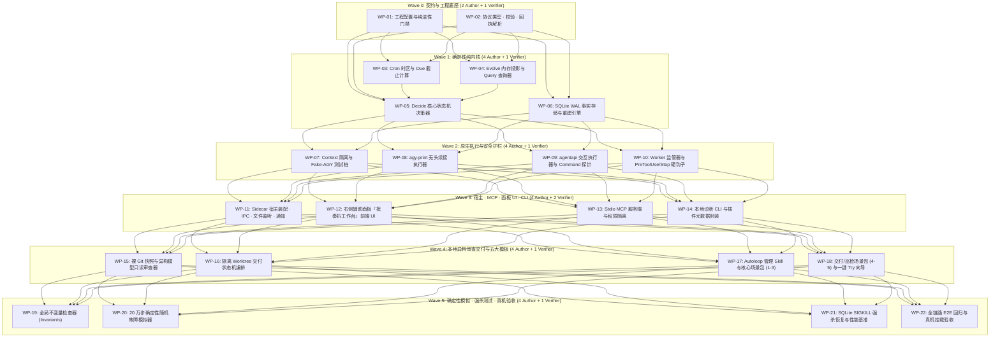

# 05. 多子代理并行任务拆解（WBS）与 Hydrogen 模型调度实战手册

> 本文档专为**「主协调者（Coordinator）指挥多个 `Gemini 4 Hydrogen` 子代理并行研发」**而编写，包含实机验证过的 Hydrogen 调度方法、零文件冲突矩阵、6 波次共 **22 个原子工作包（WP-01 ～ WP-22）** 以及可直接复制派单的指令模板。

---

## 1. 关键实操指南：如何在 Antigravity 中正确用 `Hydrogen` 跑并行子代理？

在本机实测中，Antigravity 内部共有 **4 个 `Gemini 4 Hydrogen` 模型档位**：

| 模型精确 ID（`model` 参数值） | UI 显示名称 | 推荐承担的子代理角色 |
| :--- | :--- | :--- |
| `gemini-4-hydrogen-xhigh` | `Gemini 4 Hydrogen (XHigh)` | **核心复杂逻辑与独立审查员（Verifier）**：如 `WP-05`（内核 `decide.ts`）、`WP-15`（异构审查器）、各波次的 `Verifier` |
| `gemini-4-hydrogen-high` | `Gemini 4 Hydrogen (High)` | **主力编码子代理（Author）**：绝大多数内核子模块、执行器、钩子、MCP、Sidecar 与模拟测试 |
| `gemini-4-hydrogen-medium` | `Gemini 4 Hydrogen (Medium)` | **标准结构化模块**：如 CLI 封装、场景 Skill 编写、静态配置与常规组件 |
| `gemini-4-hydrogen-low` | `Gemini 4 Hydrogen (Low)` | 极轻量文本整理或冒烟巡检（不建议用于核心状态机编码） |

### 两种启动 Hydrogen 子代理的正确姿势（必读避坑！）

- **方式 A（强烈推荐 · 原生集群并行）：使用 Antigravity 内置 `swarm` 工具（可输入 `/teamwork` 或直接让主代理启动 Swarm）**
  - **核心优势**：
    1. `swarm{action: "add", ...}` **原生支持为每个子代理单独钉死精确模型 ID**（如 `model: "gemini-4-hydrogen-high"` 或 `model: "gemini-4-hydrogen-xhigh"`），哪怕你当前主对话用的是 Carbon 模型也完全不受影响！
    2. 支持 `workspace: "share"`，为每个编码子代理自动切出独立的 Git 工作树副本，多代理同时改代码、跑测试互不踩踏！
    3. 自带共享看板（Board）与 `@mention` 点对点移交（Author 写完直接 `@verifier` 审查，不占主对话上下文）。
- **方式 B（备选 · 轻量单会话派发）：将主对话模型切换为 `Gemini 4 Hydrogen (High)` 后使用 `invoke_subagent`**
  - **注意机制限制**：`invoke_subagent` 的 `Model` 参数仅接受 `"inherit" | "flash_lite" | "flash" | "pro"` 四个枚举值。因此若走 `invoke_subagent`，需先在顶部模型选择器将当前会话切换为 `Gemini 4 Hydrogen (High)`，子代理以 `Model: "inherit"` + `Workspace: "share"` 继承 Hydrogen 模型运行。

> **前置准备命令**（开启 Wave 0 前在仓库根目录执行一次）：
> ```bash
> cd <path-to-Antigravity-autoloop>
> git init && git add . && git commit -m "docs: initialize architecture and WBS specs"
> ```

---

## 2. 全局波次依赖图（DAG）与并发度规划

全项目共拆分为 **6 个波次（Wave 0 ～ Wave 5）、22 个原子工作包（WP-01 ～ WP-22）**，单波次最高并行度为 **4 个 Author + 1～2 个 Verifier**：



> **注**：在 Wave 1 中，`WP-03`、`WP-04`、`WP-06` 可第一拍同时并行启动；由于三者的函数签名已在规范中锁死，`WP-05`（`decide.ts`）也可基于签名同步编写并在合流时联调，或等 `WP-03`/`WP-04` 完成后立即合入（耗时最短、零返工）。

---

## 3. 22 个原子工作包（Work Packages）超细颗粒度规格书

### Wave 0：工程脚手架与冻结协议层

#### `WP-01`：Node 24 零依赖工程底座与架构纯洁性门禁
- **推荐模型**：`gemini-4-hydrogen-high`
- **前置依赖**：无
- **独占写路径（Owned Paths）**：
  - `package.json`
  - `tsconfig.json`
  - `.gitignore`
  - `kernel/errors.ts`
  - `tests/purity.test.ts`
- **具体任务清单**：
  1. 配置 `package.json`（`"type": "module"`，`"engines": {"node": ">=24"}`，**无 `dependencies`**，`devDependencies` 配置 `typescript`、`@types/node`，定义 `typecheck`、`test`、`test:quick`、`test:sim` 脚本）。
  2. 配置 `tsconfig.json`（开启 `strict: true`、`noEmit: true`、`allowImportingTsExtensions: true`、`erasableSyntaxOnly: true`）。
  3. 实现 `kernel/errors.ts`（导出 `InputError`、`AuthError`、`NotFoundError`、`ConflictError`）。
  4. 实现 `tests/purity.test.ts`：扫描 `kernel/` 与 `protocol/` 下所有 `.ts` 文件，断言：
     - `protocol/` 零外部模块导入；
     - `kernel/` 除 `kernel/store.ts` 允许导入 `node:sqlite` 与 `node:crypto`（仅哈希校验）外，其余文件零 `node:*` IO 模块导入；
     - `kernel/` 零 `Date.now`、零无参 `new Date()`、零 `Math.random`、零 `process.env`、零 `fetch`；
     - `kernel/` 与 `protocol/` 零具体运行时/模型硬编码词（`agentapi`、`sidecar_sdk`、`feishu` 等）。
- **验收命令**：`npm run typecheck && node --test tests/purity.test.ts`

#### `WP-02`：冻结协议类型、输入边界校验与回执解析器
- **推荐模型**：`gemini-4-hydrogen-high`
- **前置依赖**：无（与 `WP-01` 完全并行）
- **独占写路径（Owned Paths）**：
  - `protocol/types.ts`
  - `protocol/validate.ts`
  - `protocol/receipt.ts`
  - `protocol/rules-schema.ts`
  - `tests/protocol.test.ts`
  - `tests/receipt.test.ts`
- **具体任务清单**：
  1. 按 [03-system-architecture-and-protocol.md](./03-system-architecture-and-protocol.md) 第 4 节完整定义并导出 `protocol/types.ts` 全部类型。
  2. 实现 `protocol/validate.ts`：严格校验 `InboundEvent`（`subject` 标识符字符集白名单、`link` 纯 ASCII URL 校验、各字段长度上限、`hops` 整数范围）及 `RunResult` 合法性；事件若夹带 `cwd`、`agent`、`access` 等越权字段直接抛 `InputError` 拒收。
  3. 实现 `protocol/receipt.ts`：
     - `promptFor(job, contextFile)`：构造严格「指令数据分离」的中文提示词（不含 `summary`/`detail` 原文）；
     - `readMessage(text)`：解析首行结论（识别 `没跑成：` / `FAILED`、`没事可做：` / `NOTHING`、默认 `done`）与最后一个 ```` ```agent-autoloop ```` 代码块；识别未闭合围栏或误标为 ```` ```json ```` 的回执并返回精确 `problem` 说明；
     - `repairPrompt(problem)`：构造不重做业务、不调工具的原地重写指令。
  4. 实现 `protocol/rules-schema.ts`：校验 `RulesConfig`（规则重名检查、`to` 引用存在性、`parallel`/`maxActive` 正整数检查、`emits` 源存在性检查）。
- **验收命令**：`node --test tests/protocol.test.ts tests/receipt.test.ts`

---

### Wave 1：确定性纯函数状态机内核与 SQLite 账本

#### `WP-03`：Cron 时区引擎与 Due 截止时间计算器
- **推荐模型**：`gemini-4-hydrogen-high`
- **前置依赖**：`WP-01`、`WP-02`
- **独占写路径（Owned Paths）**：
  - `kernel/cron.ts`
  - `kernel/due.ts`
  - `tests/cron-due.test.ts`
- **具体任务清单**：
  1. 实现 `kernel/cron.ts`：基于 `Intl.DateTimeFormat` 支持任意 IANA 时区的 5 字段标准 Cron 解析；实现 `nextRun(expr, tz, afterMs)` 与 `latestBefore(expr, tz, atMs)`，正确处理夏令时跳过/重复时刻，保证休眠唤醒后仅补最近一次。
  2. 实现 `kernel/due.ts`：纯函数 `deadlines(view, now)`，统一汇总四类未来唤醒点：定时规则 `next_at`、复查定时器 `timers.at`、失败轮次退避 `runs.not_before`、运行租约超时 `RUN_LEASE (5 min)`、带 `until` 的规则暂停自动恢复点。
- **验收命令**：`node --test tests/cron-due.test.ts`

#### `WP-04`：内存状态演化投影（`evolve`）与领域查询器（`query`）
- **推荐模型**：`gemini-4-hydrogen-high`
- **前置依赖**：`WP-01`、`WP-02`
- **独占写路径（Owned Paths）**：
  - `kernel/evolve.ts`
  - `kernel/query.ts`
  - `tests/evolve-query.test.ts`
- **具体任务清单**：
  1. 实现 `kernel/evolve.ts`：定义 `Table`（`config`、`events`、`runs`、`run_events`、`cards`、`timers`、`schedules`、`pauses`、`seen`、`due`）、`Fact`、`Change` 与 `View`（支持 `.get()`、`.set()`、按过滤条件索引查询 `rows()`，以及零副作用草稿分支 `.fork()`）。
  2. 实现 `kernel/query.ts`：纯查询辅助函数——通配符事件路由匹配 `typeMatches`、并发槽位占用检查（`group.parallel`、`rule.maxActive`、`agent.maxActive`、全局 `capacity`）、同组未结卡片范围 `openInScope`、单轮 `Job` 组装器 `jobOf(view, runId)`、以及单轮因果链组装器 `whyOf(view, runId)`。
- **验收命令**：`node --test tests/evolve-query.test.ts`

#### `WP-05`：核心决策引擎（`decide.ts`）全套状态机实现
- **推荐模型**：`gemini-4-hydrogen-xhigh`
- **前置依赖**：`WP-03`、`WP-04`
- **独占写路径（Owned Paths）**：
  - `kernel/decide.ts`
  - `tests/decide-routing.test.ts`
  - `tests/decide-lifecycle.test.ts`
  - `tests/hops-breaker.test.ts`
- **具体任务清单**：
  1. 实现唯一纯函数入口 `decide(view, input, now, env) -> { facts, value }`，覆盖全部输入指令：
     - `configureRules`：写入规则新版本并重算 `schedules`；若某规则被移除，自动取消其未领取的排队轮次并推通知卡；
     - `ingestEvent`：按 `source + id` 幂等去重；检查 `hops > 8` 熔断告警；区分生效规则派单与暂停规则跳过记录（`paused`）；同事项（`rule + lane`）已有 `queued` 轮次时自动合流；
     - `claimWork`：按并发配额分配任务，签发单轮次 HMAC `token`，调用 `settleSession` 计算安全的待续接 `session`（排除 `cancelled` 与仍在运行/`unknown` 的会话）；支持相同 `claim` 幂等重领；处理心跳续租与待取消轮次列表下发；
     - `markStarted` / `submitResult`：校验轮次 `token` 与重放幂等（同内容返回原确认，异内容抛 409 `ConflictError`）；原子应用回执 `ask`、`notice`、`resolve`、`later`、`events`（继承 `hops + 1` 并核验 `emits` 白名单）；处理失败指数退避（最多 10 次）与停止态强制归 `cancelled`；
     - `answerCard` / `resolveCard` / `stopRun`：确保单张 `open` 卡片只能被回答或结案一次，回答自动生成 `answer_event` 唤醒原事项并携带原 `session`；
     - `pauseRule` / `resumeRule` / `replayRule` / `runRule` / `tick`：完整实现暂停跳过不积压、恢复返回跳过清单、`replay` 按 `since` 每条仅补一次、以及时钟推进触发到期任务。
- **验收命令**：`node --test tests/decide-routing.test.ts tests/decide-lifecycle.test.ts tests/hops-breaker.test.ts tests/purity.test.ts`

#### `WP-06`：基于 `node:sqlite` 的单事务事件溯源存储层
- **推荐模型**：`gemini-4-hydrogen-high`
- **前置依赖**：`WP-01`、`WP-02`（可与 `WP-03`/`WP-04` 同步进行，通过 `Fact`/`View` 接口对接）
- **独占写路径（Owned Paths）**：
  - `kernel/store.ts`
  - `sidecars/hub/state-queries.ts`
  - `tests/store-rebuild.test.ts`
- **具体任务清单**：
  1. 实现 `kernel/store.ts`：使用 Node 24 内置 `DatabaseSync` 开启 `PRAGMA journal_mode = WAL; PRAGMA synchronous = FULL; PRAGMA busy_timeout = 5000;`。
  2. 实现单事务 `commit(facts)`：在 `BEGIN IMMEDIATE ... COMMIT` 中同时追加 `facts(seq, at, type, payload)` 与更新 `projections(collection, key, data)` 及 `meta(schema_fingerprint, last_seq, high_water_marks)`。
  3. 实现指纹校验与无迁移自动重放：当 `SCHEMA_FINGERPRINT` 变化时，清空 `projections` 并流式重放全部 `facts` 重建完整内存与磁盘投影，自动创建 SQL 只读查询视图（`events`、`runs`、`cards`、`timers` 等）。
  4. 实现 `sidecars/hub/state-queries.ts`：高效聚合今日与近 7 日轮次数、输入/输出/缓存 Token 消耗、各流水线计数与分页列表查询。
- **验收命令**：`node --test tests/store-rebuild.test.ts tests/purity.test.ts`

---

### Wave 2：Antigravity 原生执行引擎与生命周期安全钩子

#### `WP-07`：运行上下文物理隔离器与 `fake-agy` 确定性测试桩
- **推荐模型**：`gemini-4-hydrogen-high`
- **前置依赖**：Wave 1 完成
- **独占写路径（Owned Paths）**：
  - `engine/context-file.ts`
  - `tests/fakes/fake-agy.mjs`
  - `tests/fakes/fake-agentapi.mjs`
  - `tests/security-isolation.test.ts`
- **具体任务清单**：
  1. 实现 `engine/context-file.ts`：为每一轮执行创建 `0700` 专属目录 `<AUTOLOOP_HOME>/runs/<run>-<attempt>/`，以 `0600` 原子写入 `context.json`（承载全部外部事件详情）与 `guard.json`（承载本轮 `access`、`cwd`、`askFirst` 与已批准卡片 `decided` 列表），并提供 14 天过期运行目录自动清理函数 `tidyRuns()`。
  2. 编写高保真可执行桩程序 `tests/fakes/fake-agy.mjs` 与 `fake-agentapi.mjs`：通过场景脚本控制其模拟 `stream-json` 输出、返回 `conversationId`、模拟首次输出语法错误回执并在收到 `--conversation` 修复请求时输出正确回执、模拟挂起退出与唤醒续接、模拟超时与进程组子进程派生。
  3. 编写 `tests/security-isolation.test.ts`：注入包含恶意换行、伪造 ```` ```agent-autoloop ```` 围栏、Prompt 注入指令的事件正文，验证生成的提示词 0 字节混入恶意正文且回执解析不被 `context.json` 污染。
- **验收命令**：`node --test tests/security-isolation.test.ts`

#### `WP-08`：主力无头执行器 `agy-runner.ts`（会话续接与增量用量采集）
- **推荐模型**：`gemini-4-hydrogen-high`
- **前置依赖**：Wave 1 完成（与 `WP-07` 并行开发，联调测试引用 `fake-agy`）
- **独占写路径（Owned Paths）**：
  - `engine/agy-runner.ts`
  - `tests/agy-runner.test.ts`
- **具体任务清单**：
  1. 实现 `engine/agy-runner.ts`：封装 `agy --print --output-format stream-json` 子进程生命周期管理。
  2. 精确实现模型映射（`--model`）、推理强度（`--effort`）、权限映射（`read`→`plan+sandbox`，`edit`→`accept-edits+sandbox`，`full`→`auto`）与会话续接（`--conversation`）。
  3. 实时解析 `stream-json` 行事件：提取 `conversationId`（一旦收下提示词立即回调 `onStarted({ session })`）、提取最终助手文本与增量 Token `usage`；区分「未启动即断连（可降级开新会话重试）」与「已启动后中断（保留原会话交由中台重派）」。
  4. 强制清洗子进程环境变量（剔除 `AUTOLOOP_OWNER_TOKEN`、`ANTIGRAVITY_SIDECAR_UI_TOKEN`），并在独立进程组（Unix `detached: true`）中运行以支持无残留杀死整棵子进程树。
- **验收命令**：`node --test tests/agy-runner.test.ts`

#### `WP-09`：交互会话唤醒器 `agentapi-runner.ts` 与零 Token 探针 `command-runner.ts`
- **推荐模型**：`gemini-4-hydrogen-high`
- **前置依赖**：Wave 1 完成
- **独占写路径（Owned Paths）**：
  - `engine/agentapi-runner.ts`
  - `engine/command-runner.ts`
  - `tests/runners-aux.test.ts`
- **具体任务清单**：
  1. 实现 `engine/command-runner.ts`：使用 `execFile` 执行参数数组（严禁 `shell: true`），传入 `AUTOLOOP_CONTEXT` 路径，零大模型开销运行本地探针脚本并解析其标准输出中的衍生事件回执。
  2. 实现 `engine/agentapi-runner.ts`：支持需要可视化 UI 会话或调用内置 `browser` 子代理的场景——优先使用 `process.env.ANTIGRAVITY_AGENTAPI_EXE`（回退 `agentapi`），首次调用 `new-conversation --model=<m> --title=<t> <prompt>`，续接时调用 `send-message <session> <prompt>`，并监听对应 `<appData>/brain/<session>/.system_generated/logs/transcript.jsonl` 的回合完结步骤提取最终回复。
- **验收命令**：`node --test tests/runners-aux.test.ts`

#### `WP-10`：Worker 监管循环 `supervisor.ts` 与 `PreToolUse` / `Stop` 硬护栏钩子
- **推荐模型**：`gemini-4-hydrogen-high`
- **前置依赖**：`WP-07`、`WP-08`、`WP-09`
- **独占写路径（Owned Paths）**：
  - `engine/supervisor.ts`
  - `hooks/pre-tool-guard.mjs`
  - `hooks/stop-receipt-check.mjs`
  - `hooks.json`
  - `tests/supervisor-and-hooks.test.ts`
- **具体任务清单**：
  1. 实现 `engine/supervisor.ts`：负责领活、路由至对应 Runner、定时上报运行中心跳、处理中台下发的 `cancel` 信号（先 `SIGTERM` 进程组，宽限期后 `SIGKILL`，确认进程彻底退出后再上报 `cancelled`）、以及当 Runner 返回回执解析 `problem` 时在原会话自动触发最多 2 次 `repairPrompt` 重写。
  2. 实现 `hooks/pre-tool-guard.mjs` 与 `hooks/stop-receipt-check.mjs`（遵循 Antigravity `hooks.json` camelCase stdin/stdout 契约）：对非 Autoloop 会话零延迟放行；对 Autoloop 会话严格执行 `access=read` 禁写、`askFirst` 未授权高危命令硬拦截（`deny`），以及回合结束前的残缺回执原地重写引导（`continue`）。
  3. 编写根目录 `hooks.json` 注册这两个钩子。
- **验收命令**：`node --test tests/supervisor-and-hooks.test.ts`

---

### Wave 3：常驻 Sidecar 宿主、MCP 控制桥、批奏折面板 UI 与 CLI

#### `WP-11`：Sidecar 宿主装配、本地 IPC 服务、文件监听源与桌面通知
- **推荐模型**：`gemini-4-hydrogen-high`
- **前置依赖**：Wave 2 完成
- **独占写路径（Owned Paths）**：
  - `sidecars/hub/sidecar.json`
  - `sidecars/hub/ipc-server.ts`
  - `sidecars/hub/file-watcher.ts`
  - `sidecars/hub/notifier.ts`
  - `sidecars/hub/main.mjs`
  - `tests/sidecar-host.test.ts`
- **具体任务清单**：
  1. 编写 `sidecars/hub/sidecar.json`：配置 `"command": "node"`, `"args": ["main.mjs"]`, `"restart_policy": "always"`, `"has_web_ui": true`, `"ui_config"` 挂载 `SIDECAR_UI_ENTRYPOINT_AUX_PANE`。
  2. 实现 `sidecars/hub/ipc-server.ts`：在 `127.0.0.1:0`（动态空闲端口写入 `0600` 的 `<AUTOLOOP_HOME>/ipc.json`）提供受 Bearer Token 保护的本地控制与事件投递接口，供本机 `mcp` 与 `cli` 调用；同时在非 Sidecar 独立测试模式下可脱离 `sidecar_sdk` 单独启动以便自动化测试。
  3. 实现 `sidecars/hub/file-watcher.ts`（`rules.json` 热重载 + 规则中的 `watch` 目录防抖事件源）与 `sidecars/hub/notifier.ts`（macOS `osascript` 参数隔离通知，仅对新创建的非静默 `ask`/`notice` 卡弹一次）。
  4. 实现 `sidecars/hub/main.mjs`：整合 `SidecarApp`、SQLite `store`、精准毫秒级 `due` 定时器调度与内置 `supervisor`，挂载全部 `/api/*` 前端接口。
- **验收命令**：`node --test tests/sidecar-host.test.ts`

#### `WP-12`：右侧辅助面板「批奏折工作台」前端 Web UI
- **推荐模型**：`gemini-4-hydrogen-high`
- **前置依赖**：Wave 2 完成（严格按第 7.1 节冻结的 `/api/*` JSON 契约独立开发，与 `WP-11` 零文件冲突并行！）
- **独占写路径（Owned Paths）**：
  - `sidecars/hub/web/index.html`
  - `sidecars/hub/web/styles.css`
  - `sidecars/hub/web/app.js`
  - `tests/ui-dom-safety.test.ts`
- **具体任务清单**：
  1. 构建高品质、高信息密度、完全复用 Antigravity 宿主语义主题变量（`--background`、`--card`、`--foreground`、`--muted-foreground`、`--primary`、`--border`，兼容深浅色且无外部被封锁 CDN 依赖）的辅助面板前端。
  2. 实现四大核心交互模块：
     - **奏折审批台（待批卡片优先置顶）**：突出显示「票拟推荐」标签、一键选项批红按钮、自由文字批复输入、普通通知一键已阅结案；
     - **自动化流水线矩阵**：展示每条规则状态徽章（运行中/空闲/已暂停）、今日完成数、一键「立即运行」「暂停/恢复」「补跑跳过事件」按钮；
     - **近期轮次与 `why` 因果抽屉**：点击任意轮次展开事件源、规则版本、模型名称、Token 用量与回执详情，并提供「强停运行中轮次」按钮；
     - **顶部状态栏**：展示今日/7 日轮次与缓存命中 Token 概览及 ETag 实时连接指示灯。
  3. **安全铁律**：全部动态文本一律使用 `textContent` / `createElement` 渲染，严禁拼接不可信字符串到 `innerHTML`，并通过 `tests/ui-dom-safety.test.ts` 静态与行为验证。
- **验收命令**：`node --test tests/ui-dom-safety.test.ts`

#### `WP-13`：`autoloop_hub` Stdio MCP 服务端与权限隔离验证
- **推荐模型**：`gemini-4-hydrogen-high`
- **前置依赖**：Wave 2 完成（与 `WP-11`、`WP-12` 并行）
- **独占写路径（Owned Paths）**：
  - `mcp/server.mjs`
  - `mcp_config.json`
  - `tests/mcp-server.test.ts`
- **具体任务清单**：
  1. 实现零依赖 Stdio JSON-RPC 2.0 MCP 服务端 `mcp/server.mjs`，读取 `<AUTOLOOP_HOME>/ipc.json` 与密钥连接本地 Sidecar IPC（若 Sidecar 未启动则可直接以只读/单事务模式操作本地 `hub.db` 给友好提示）。
  2. 注册第 7.2 节全部 `autoloop_*` 工具，标注准确的 `readOnlyHint` 与 `destructiveHint`。
  3. **自批防护**：若检测到当前进程环境带有 `AUTOLOOP_RUN_ID`（即当前调用方本身是被 Autoloop 派单的子代理），自动隐藏 `autoloop_answer`、`autoloop_resolve`、`autoloop_pause`、`autoloop_stop` 等本人专属管理权限工具，仅暴露只读查询或受控事件上报，从协议层彻底杜绝子代理自己批自己的卡片！
  4. 编写 `mcp_config.json` 供插件自动挂载。
- **验收命令**：`node --test tests/mcp-server.test.ts`

#### `WP-14`：本地诊断 CLI 与 Antigravity 插件包清单封装
- **推荐模型**：`gemini-4-hydrogen-medium`
- **前置依赖**：`WP-11`
- **独占写路径（Owned Paths）**：
  - `cli/main.ts`
  - `bin/autoloop.mjs`
  - `plugin.json`
  - `rules/AGENTS.md`
  - `assets/logo.svg`
  - `tests/cli.test.ts`
- **具体任务清单**：
  1. 实现本地命令行入口 `cli/main.ts` 与 `bin/autoloop.mjs`：支持 `status [--json]`、`why <run>`、`check [draft.json]`、`explain [draft.json]`、`emit <type> [--dry-run]`、`answer`、`pause`、`resume`、`replay`、`run`、`stop`。
  2. 编写符合 Antigravity 插件规范的 `plugin.json`（仅使用合法顶层字段：`name`、`displayName`、`description`、`version`、`logo`、`suggestedPrompts`）、极简 SVG 图标 `assets/logo.svg`，以及插件激活时注入的精简协同规则 `rules/AGENTS.md`（控制在 2KB 以内，指引主代理优先使用 `autoloop_*` MCP 工具与 `[Autoloop 工作台](sidecar://autoloop/hub/)` 面板胶囊）。
- **验收命令**：`node --test tests/cli.test.ts`

---

### Wave 4：本地异构模型审查交付流水线与开箱场景包

#### `WP-15`：裸 Git 快照提取器与异构模型只读审查器
- **推荐模型**：`gemini-4-hydrogen-xhigh`
- **前置依赖**：Wave 3 完成
- **独占写路径（Owned Paths）**：
  - `delivery/snapshot.ts`
  - `delivery/reviewer.ts`
  - `tests/delivery-reviewer.test.ts`
- **具体任务清单**：
  1. 实现 `delivery/snapshot.ts`：只从主干分支（如 `main`）读取 `.autoloop/delivery.json` 与 `AGENTS.md` 中的 `## 审查要点`，使用 `git diff <merge-base>..<head>` 从 Git 对象库直接提取纯文本差异快照写入隔离只读文件，**绝不在主目录检出待审分支或执行待审分支中的 hooks**。
  2. 实现 `delivery/reviewer.ts`：根据分支作者模型自动挑选**异构审查模型**（例如作者为 `carbon` / `opus` 时默认派给 `gemini-4-hydrogen-xhigh`；作者为 `hydrogen` 时默认派给 `gemini-4-carbon-high`），以 `--mode plan --sandbox` 无记忆只读模式执行审查，要求输出结构化 `{"findings":[{"title":"file:line 问题","text":"触发条件与后果"}]}`；强制维护审查账本（绑定提交 SHA，同一 SHA 不重审，累计往返超过 3 轮自动转交一张 `ask` 卡片由人工裁决）。
- **验收命令**：`node --test tests/delivery-reviewer.test.ts`

#### `WP-16`：隔离 Worktree 自动化检查与分支交付状态机
- **推荐模型**：`gemini-4-hydrogen-high`
- **前置依赖**：`WP-15`
- **独占写路径（Owned Paths）**：
  - `delivery/pipeline.ts`
  - `tests/delivery-pipeline.test.ts`
- **具体任务清单**：
  1. 实现 `delivery/pipeline.ts`：完整编排五步本地交付闭环：
     - Step 1：调用 `reviewer.ts` 完成异构只读审查（有阻塞项则发衍生事件退回修复或通知）；
     - Step 2：在系统临时目录创建一次性 `git worktree` 运行主干指定的 `checkCommand`（如 `npm run typecheck && npm run test:quick`），跑完立即 `git worktree remove --force` 清理；
     - Step 3：核对目标分支未发生冲突漂移、未触碰需人工终审的敏感路径（若触碰则发 `ask` 奏折卡等待一键放行）；
     - Step 4：执行安全合并（支持本地目标分支快进/Squash 合并，或可选调用已登录的 `gh pr merge`）；
     - Step 5：执行合并后健康/冒烟命令，输出结案回执。
- **验收命令**：`node --test tests/delivery-pipeline.test.ts`

#### `WP-17`：中台管理 Skill 与内置场景模板包（1～3 + 新观点拆解流）
- **推荐模型**：`gemini-4-hydrogen-medium`
- **前置依赖**：Wave 3 完成（与 `WP-15` 并行）
- **独占写路径（Owned Paths）**：
  - `skills/autoloop-admin/SKILL.md`
  - `skills/recipe-morning-brief/SKILL.md`
  - `skills/recipe-issue-triage/SKILL.md`
  - `skills/recipe-code-sweep/SKILL.md`
  - `skills/recipe-idea-to-sop/SKILL.md`
- **具体任务清单**：
  1. 编写 `skills/autoloop-admin/SKILL.md`：教会 Antigravity 主代理如何帮用户编写/校验 `rules.json`、配置不同 Hydrogen/Carbon 模型分工、管理 `.autoloop/decisions.md` 与 `declined.md` 圣旨账本、排查 `why` 因果链。
  2. 编写四套高质量内置业务 SOP Skill：
     - `recipe-morning-brief`：每日汇总指定工作区 Git 提交、未结卡片与待办笔记生成简报；
     - `recipe-issue-triage`：读取本地 `.autoloop/inbox/` 或 GitHub Issue 探针事件，先核实代码现状再修复，涉及破坏性改动发 `ask` 奏折卡；
     - `recipe-code-sweep`：每周定时用 Hydrogen 扫描重复逻辑、死代码与过期注释并提交待审分支；
     - `recipe-idea-to-sop`：「新观点/外部教程 → 盘点本机能力与历史圣旨 → 编写拆解方案并递交票拟卡片 → 获批后分步试跑产出样片 → 沉淀为永久 Skill + 规则」五步标准协同 SOP。
- **验收命令**：校验所有 `SKILL.md` YAML frontmatter（`name`、`description`）合法且示例路径与命令真实匹配。

#### `WP-18`：交付与健康巡检模板包（4～5）、默认规则样板与一键 `try` 试跑流
- **推荐模型**：`gemini-4-hydrogen-high`
- **前置依赖**：`WP-16`
- **独占写路径（Owned Paths）**：
  - `skills/recipe-pr-delivery/SKILL.md`
  - `skills/recipe-health-watch/SKILL.md`
  - `skills/recipe-health-watch/scripts/probe-url.mjs`
  - `examples/rules.starter.json`
  - `cli/try.ts`
  - `tests/try-flow.test.ts`
- **具体任务清单**：
  1. 编写 `recipe-pr-delivery` 与 `recipe-health-watch`（附带零 Token 探测脚本 `probe-url.mjs`：正常返回 200 时静默退出 0 花费，连续异常才产出 `service.down` 事件唤醒 Agent 排查，恢复后自动 `resolve` 原卡片）。
  2. 编写开箱即用的 `examples/rules.starter.json`（预置 `hydrogen-fast`、`hydrogen-reviewer`、`carbon-architect` 三个内置模型角色模板）。
  3. 实现 `cli/try.ts`（挂入 `cli/main.ts` 子命令或独立入口）：自动创建试跑事项 → 唤醒 Hydrogen 发起一张「选一个你喜欢的主题色」批奏折卡片 → 验证进程已退出零消耗挂起 → 引导用户在辅助面板或终端一键批复 → 自动接回原会话完成结案回写。
- **验收命令**：`node --test tests/try-flow.test.ts`

---

### Wave 5：工业级模拟验证、强杀恢复压测与全链路真机验收

#### `WP-19`：全局状态机不变量检查器（`sim/invariants.ts`）
- **推荐模型**：`gemini-4-hydrogen-xhigh`
- **前置依赖**：Wave 4 完成
- **独占写路径（Owned Paths）**：
  - `sim/invariants.ts`
  - `tests/invariants-unit.test.ts`
- **具体任务清单**：
  1. 实现 `assertInvariants(store, view)`，在任意一步状态变迁后核验 12 条铁律：
     - `facts` 序号严格连续递增，重放 `facts` 得到的投影与当前持久 `projections` 逐字节完全相等；
     - 同一 `group` 下处于 `claimed` 状态的轮次数永不超过 `parallel`；单规则与单 Agent 永不超过各自 `maxActive`；
     - 同一事项（`rule + lane`）永不同时存在两个 `claimed` 轮次，也永不同时存在两个 `queued` 轮次；
     - 没有任何两个活跃轮次同时持有同一个 `session`（`conversationId`）；
     - 任何 `hops > 8` 的事件其关联派发轮次数必为 `0`；
     - 任何 `fyi: true` 通知卡自创建起必为 `closed` 且带 `closed_at`；任何卡片不可能既被 `answer` 又被手动 `resolve` 覆盖；
     - 处于 `cancel_at` 停止标记的轮次终态只能是 `cancelled`（或已完成终态），绝不回到 `queued`。
- **验收命令**：`node --test tests/invariants-unit.test.ts`

#### `WP-20`：200,000 步确定性随机故障与重放模拟器（`sim/random.ts`）
- **推荐模型**：`gemini-4-hydrogen-high`
- **前置依赖**：`WP-19`
- **独占写路径（Owned Paths）**：
  - `sim/random.ts`
  - `tests/simulation.test.ts`
- **具体任务清单**：
  1. 使用确定性种子伪随机数发生器（PRNG，单一整数种子即可 100% 复现任意故障轨迹），随机生成事件洪峰、重复投递、网络丢包重交、乱序心跳、规则热修改/删除、暂停与 `replay`、回执衍生循环、卡片并发点击等操作序列，每步调用 `assertInvariants`。
  2. `tests/simulation.test.ts` 默认跑 20,000 步快速回归；命令行 `node sim/random.ts 24301 200000` 跑完整 20 万步深测。
- **验收命令**：`npm run test:sim`

#### `WP-21`：SQLite `SIGKILL` 真进程崩溃恢复与性能基准脚本
- **推荐模型**：`gemini-4-hydrogen-high`
- **前置依赖**：`WP-19`（与 `WP-20` 完全并行）
- **独占写路径（Owned Paths）**：
  - `sim/crash.ts`
  - `scripts/benchmark.ts`
  - `tests/crash-recovery.test.ts`
- **具体任务清单**：
  1. 实现 `sim/crash.ts`：循环拉起真实子进程写入随机事件、派单、提交回执与批卡，在任意随机毫秒向子进程发送 `SIGKILL` 强杀，重启后校验：凡父进程已收到确认的记录 100% 存在且满足全部 `assertInvariants`。
  2. 实现 `scripts/benchmark.ts`：按标准口径实测冷启动耗时、空闲 RSS 内存、连续单事务持久化吞吐（条/秒）与 `p99` 派活延迟，输出 Markdown 报告表格。
- **验收命令**：`node --test tests/crash-recovery.test.ts && npm run benchmark`

#### `WP-22`：全链路端到端回归与 Antigravity 真机插件挂载验收
- **推荐模型**：`gemini-4-hydrogen-xhigh`
- **前置依赖**：`WP-20`、`WP-21`
- **独占写路径（Owned Paths）**：
  - `tests/e2e-full-loop.test.ts`
  - `scripts/install-local-plugin.sh`
- **具体任务清单**：
  1. 编写 `tests/e2e-full-loop.test.ts`：一次性串联 Sidecar HTTP API + MCP Stdio + `PreToolUse`/`Stop` 钩子 + 本地 Git 分支异构审查交付流水线，跑通全栈自动化闭环。
  2. 编写幂等安全的本地插件链接脚本 `scripts/install-local-plugin.sh`（将本仓库软链至 `~/.gemini/config/plugins/autoloop`，绝不触碰 `~/.gemini/config/config.json`），输出供用户在 Antigravity 中点击启用的 `[autoloop](customization://autoloop)` 与 `[Autoloop 工作台](sidecar://autoloop/hub/)` 验收指引。
- **验收命令**：`npm test && npm run typecheck`

---

## 4. 即拷即用的 Hydrogen Swarm 派单模板（Coordinator 操作手册）

当你准备在下一阶段正式启动编码时，只需在对话中让主协调者按波次执行如下 `swarm` 动作即可（以下以 **Wave 0** 和 **Wave 1** 为例）：

### 示例：一键启动 Wave 0（2 名 Hydrogen High 开发员 + 1 名 Hydrogen XHigh 审查员）

```jsonc
// 1. 命名集群
swarm({ "action": "title", "title": "Antigravity-Autoloop Wave 0: Contracts & Scaffold" })

// 2. 派发 WP-01 (独立共享工作树 + 钉死 gemini-4-hydrogen-high)
swarm({
  "action": "add",
  "name": "wp01-scaffold",
  "model": "gemini-4-hydrogen-high",
  "workspace": "share",
  "brief": "你负责 WP-01。请先阅读 AGENTS.md、docs/03-system-architecture-and-protocol.md 和 docs/05-subagent-wbs-and-hydrogen-guide.md 中的 WP-01 章节。你独占且只能创建/修改：package.json, tsconfig.json, .gitignore, kernel/errors.ts, tests/purity.test.ts。严禁添加任何 runtime dependencies，开启 erasableSyntaxOnly。完成后运行 npm run typecheck && node --test tests/purity.test.ts，在本身工作树 git commit 后，将 commit SHA 与测试结果在看板 @verifier-w0 请求审查。"
})

// 3. 派发 WP-02 (独立共享工作树 + 钉死 gemini-4-hydrogen-high)
swarm({
  "action": "add",
  "name": "wp02-protocol",
  "model": "gemini-4-hydrogen-high",
  "workspace": "share",
  "brief": "你负责 WP-02。请先阅读 AGENTS.md、docs/03-system-architecture-and-protocol.md 第4节和 docs/05-subagent-wbs-and-hydrogen-guide.md 中的 WP-02 章节。你独占且只能创建/修改：protocol/types.ts, protocol/validate.ts, protocol/receipt.ts, protocol/rules-schema.ts, tests/protocol.test.ts, tests/receipt.test.ts。实现全部冻结接口、白名单校验、指令数据分离提示词构造与回执解析器。完成后运行 node --test tests/protocol.test.ts tests/receipt.test.ts，git commit 后在看板 @verifier-w0 请求审查。"
})

// 4. 派发独立只读审查员 Verifier (钉死 gemini-4-hydrogen-xhigh)
swarm({
  "action": "add",
  "name": "verifier-w0",
  "model": "gemini-4-hydrogen-xhigh",
  "workspace": "inherit",
  "brief": "你是 Wave 0 的独立只读审查员（严禁自己修改任何业务文件）。收到 @wp01-scaffold 或 @wp02-protocol 的提审消息后，对照 AGENTS.md 第三节审查清单与 docs/03-system-architecture-and-protocol.md 核对其分支提交并运行测试。若发现缺陷，指明 file:line 与复现方法并 @对应作者 修复；全部通过后 @coordinator 报告可合并的分支与 commit SHA。"
})
```
