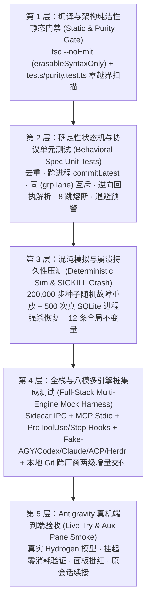

# 06. 全链路测试策略、确定性模拟与验收标准（Testing & Acceptance）

## 1. 测试设计核心原则

继承并强化原版 `agent-autoloop` 最具工程价值的验证理念：
1. **行为规格优先，不为迁就实现改预期**：每一条单元测试都对应一个真实的用户可见行为或历史踩坑事故（如：重复投递不跑两遍、回执写错不重做业务、停止中的失败不重排、已接上会话的中断不换新会话重做）。
2. **每个测试文件首行写明「它防哪种故障」**：拒绝测试内部私有函数名或凑行数的脆弱快照测试。
3. **测试分层零外部副作用**：日常测试与 CI 测试一律使用临时隔离目录（`mkdtempSync` 作为 `AUTOLOOP_HOME`）、显式注入的虚拟时钟 `now` 与本地 `fake-agy` 进程，**绝不消耗真实模型 Token、绝不弹真实系统桌面通知、绝不污染用户 `~/.gemini` 配置**。

---

## 2. 五层验证金字塔全景

全仓当前常态化自动化测试规模：**66 个测试套件（suites）、240 项自动化测试用例（tests）**（`npm test` 100% 离线零外部副作用执行）。



---

## 3. 各层必测场景矩阵（Test Specification Matrix）

### 第 1 层：静态类型与纯洁性门禁
| 测试项 | 覆盖文件 | 通过判定标准 |
| :--- | :--- | :--- |
| TypeScript 严格模式与可擦除语法检查 | 全仓 `.ts` | `npm run typecheck` 退出码为 `0` |
| 内核纯洁性扫描 | `tests/purity.test.ts` | `kernel/` 无时钟、随机数、网络、环境变量及具体模型/宿主字符串；`protocol/` 零外部依赖 |
| 前端 XSS 零风险扫描 | `tests/ui-dom-safety.test.ts` | `sidecars/hub/web/` 零未消毒 `innerHTML` / `outerHTML` / `document.write`；注入 `` 卡片标题仅渲染为纯文本 |

### 第 2 层：协议、内核状态机与安全隔离单元测试
| 测试场景域 | 关键必测用例 | 对应测试文件 |
| :--- | :--- | :--- |
| **指令数据分离与防注入** | 1. 事件 `summary`/`detail` 含多行伪造指令或未闭合代码块围栏，确认主提示词 0 字节包含该文本；<br/>2. 事件夹带 `cwd`、`access`、`model` 字段直接抛 `InputError` 拒收；<br/>3. 非法 `subject`（如以 `-` 或 `/` 打头或含空格）、非 ASCII 或 `file://` 等非 `http(s)` `link` 直接拒收；省略 `askFirst` 自动填充 7 项默认红线，同 `group` 不同有效 `parallel` 直接拒收。 | `tests/protocol.test.ts`<br/>`tests/security-isolation.test.ts`<br/>`tests/v11-kernel-store.test.ts` |
| **回执解析与无损纠错** | 1. 正常解析五种回执字段与首行三种状态（自动剥离前导 `**`/`###`/`>`/列表等 Markdown 装饰符）；<br/>2. 自底向上逆向围栏扫描不受正文未闭合代码块干扰，代码块未单独占行闭合、JSON 语法错误、误写为 ```` ```json ```` 回执时准确返回 `problem` 并保留首行结论；<br/>3. 业务输出中的普通示例 JSON 代码块不被误判为回执报错。 | `tests/receipt.test.ts`<br/>`tests/v11-kernel-store.test.ts` |
| **去重、排队合并与三级并发** | 1. 同一 `source + id` 重复发送只记一次、返回 `duplicate: true`；<br/>2. 同一事项（`rule + subject`）一轮 `claimed` 期间连续到达 5 条新事件，队列中合并为 **唯一** 下一轮；<br/>3. 同 `(grp, lane)` 跨规则单活互斥，以及 `group.parallel`、`rule.maxActive`、`agent.maxActive` 与 Worker `capacity` 并发阀门同时准确生效。 | `tests/decide-routing.test.ts`<br/>`tests/v11-kernel-store.test.ts` |
| **会话续接与异常恢复** | 1. `ask` 被回答或 `later` 到期后，下一轮自动携带提问/约定时保存的 `conversationId`（`context.decided` 同时保留 `"decided" | "done"` 历史裁决并排除当轮 `answers`）；<br/>2. 上一轮被用户 `stop` 取消或更换了目标模型时，强制开启新会话不沿用旧会话；<br/>3. 两个并发轮次绝不同时打开同一个仍在运行或 `unknown` 的 `conversationId`；<br/>4. 失败按 `60s * 2^(attempt-1)`（上限 30m）退避重试并将期间新排队事件并入重试轮次，第 3 次连续失败发末行摘要预警卡（恢复后自动关闭），满 10 次转终态 `failed` 并推告警卡；终态自动清理已触发 `timers`。 | `tests/decide-lifecycle.test.ts`<br/>`tests/v11-kernel-store.test.ts` |
| **卡片幂等与结案互斥** | 1. 同事项同 `key` 已有 `open` 卡片时重复 `ask` 不发第二张卡；<br/>2. 同一张提问卡连点两次不同选项，仅第一次生效，第二次抛冲突或忽略；<br/>3. `fyi: true` 通知创建即 `closed`（`tell: "always"` 无卡完成自动生成 `fyi` 简报卡并推送带 `[<rule>]` 前缀的通知）；<br/>4. 回执 `resolve` 只能关闭同来源同组且领活前已存在的卡片，越界卡片记入 `rejected` 且不影响本轮其他回执生效。 | `tests/decide-lifecycle.test.ts`<br/>`tests/v11-kernel-store.test.ts` |
| **8 跳熔断与暂停补跑** | 1. 衍生事件经过 `ask` 人工问答与 `later` 复查后 `hops` 持续累加不归零，第 9 跳（`hops = 9 > 8`）只入账不派单并推单张熔断通知；<br/>2. `pause` 期间定时规则跳过不积压，事件规则记入 `paused` 不入队；`resume` 准确返回跳过事件清单；`replay` 按 `since` 补跑且重复执行 `replay` 不会把同一事件补跑第二次。 | `tests/hops-breaker.test.ts`<br/>`tests/cron-due.test.ts` |
| **单事务账本、跨进程追平与零迁移重建** | 1. 更改 `SCHEMA_FINGERPRINT` 或删空投影表后重启 `store`，从 `facts` 全量重放后的每张表记录、序列号与自增高水位与崩溃前一模一样；<br/>2. 外部进程（CLI / 离线 MCP）直写 `hub.db` 后，宿主 `commitLatest` 在 `BEGIN IMMEDIATE` 锁内基于 `view.fork()` 增量追平且回滚零内存脏写。 | `tests/store-rebuild.test.ts`<br/>`tests/v11-kernel-store.test.ts` |

### 第 3 层：20 万步确定性模拟与 `SIGKILL` 崩溃压测
| 压测脚本 | 执行参数与规模 | 验收红线 |
| :--- | :--- | :--- |
| **快速随机模拟（每次提交必跑）** | `node sim/random.ts 24301 20000` | 2 万步内覆盖乱序、重放、超时、取消、暂停补跑，12 条不变量 **0 违背**，耗时 `< 5s` |
| **深度随机模拟（里程碑准出必跑）** | `node sim/random.ts 24301 200000` | 20 万步全状态空间探索，12 条不变量 **0 违背**；任意失败可通过同一种子毫秒级复现 |
| **真 SQLite 强杀恢复压测** | `node sim/crash.ts 500 12648430` | 500 轮真实子进程随机时刻 `SIGKILL` 强杀重启，已确认事实 **0 丢失**、投影重放 **100% 一致** |

### 第 4 层：Antigravity 运行时与八模全通道桩集成测试（含 `v1.1.0` & `v1.2.0` 专项套件）
1. **执行器容错、生命周期硬钩子与控制面自保护（`tests/supervisor-and-hooks.test.ts`、`tests/v11-engine-guard.test.ts`）**：
   - 验证 `supervisor.ts` 在首轮业务已完成（`done`/`nothing`）但 2 次 `repairPrompt` 后回执仍损坏（或无会话）时走 `discardReceipt` 安全降级结案并推告警卡（绝不重跑 10 次业务）；验证坏历史会话 `!started` 自动降级无会话重试与延迟 `session` 二次 `markStarted` 补报；验证 `agy-runner.ts` 流式 `result` 后 `30s` 宽限回收防孙进程挂死管道。
   - 构造真实 stdin JSON 喂给 `hooks/pre-tool-guard.mjs`，验证：普通无环境变量会话返回 `allow`；密级文件（`owner.token`/`master.key`/`guard.json`）零访问封锁、`hub.db*` 与 `rules.json` 写封锁（含 `guard.json` 损坏 fail-closed）；`access: "read"` 或未获批 `askFirst` 在 `env`/`sudo`、子 Shell `-c`、`node -e`、`python3 -c` 下均返回 `deny`；同时验证 `isApprovedChoice` 对“不要删，先看日志”“算了”“don't”等中英文否定/暂缓批复绝不误写入 `approvedKeys`。
   - 构造含残缺 ```` ```agent-autoloop ```` 代码块的临时 `transcript.jsonl` 喂给 `hooks/stop-receipt-check.mjs`，验证返回 `{"decision":"continue"}` 且第 3 次连续残缺时自动放行交由 Worker 兜底，绝不卡死回合。
2. **MCP 自批防护测试（`tests/mcp-server.test.ts`）**：
   - 正常客户端环境调用 `tools/list` 能拿到完整 `autoloop_answer` / `autoloop_stop` 等管理方法；
   - 注入 `AUTOLOOP_RUN_ID=1` 模拟受控业务子代理调用 `tools/list` 与 `tools/call`，验证 `autoloop_answer` 被隐藏且直接强行调用返回权限拒绝错误。
3. **本地 Git 跨厂商异构两级增量审查交付测试（`tests/delivery-pipeline.test.ts`、`tests/delivery-reviewer.test.ts`、`tests/v11-delivery-incremental.test.ts`、`tests/v12-multi-engine-integration.test.ts`）**：
   - 创建临时 Git 仓库（含 `main` 与 `feat/demo` 分支），验证：
     - 主工作区如果有未提交修改，完全不受后台 Worktree 检查与快照审查干扰；
     - 第 1 轮报出 `blocking` 缺陷（需写明具体触发路径，普通 `tests/*.test.ts` 分节轻读而 `purity`/`security-isolation` 门禁测试严审）时拒绝合并并登记账本；跨分支名按 `(headSha, mergeBaseSha, reviewerRunner, reviewerCommand, reviewerModel)` 命中缓存绝不重审同一提交，且不同审查执行器/命令配置严格隔离；
     - 推入代码修复提交后，第 2 轮提取 `prevSha..headSha` 生成 `0600` `incremental-diff.patch` 并结合第 1 轮阻塞清单定向复核通过合入 `main`；若第 2 轮仅改 `*.md`（`docs_only`）或发生 rebase 非祖先改写则自动回退完整 `diff.patch`；默认 `30m` 超时、满 `2` 轮仍未决自动转人工 `ask` 奏折卡。
4. **`v1.1.0` 三大专项回归测试套件索引**：
   - `tests/v11-kernel-store.test.ts`：跨进程 `store.commitLatest` 增量追平与回滚零脏写、`DEFAULT_ASK_FIRST` 与同组有效 `parallel` 一致性、`http(s)` 链接白名单、首行 Markdown 剥离与逆向围栏扫描、同 `(grp, lane)` 跨规则互斥、`context.decided` 含 `"done"`、`60s` 指数退避与第 3 次连续失败末行预警卡、`tell: "always"` 自动 `fyi` 简报与 `[<rule>]` 通知前缀、终态 `timers` 自动清理。
   - `tests/v11-engine-guard.test.ts`：2 次回执修复耗尽 `discardReceipt` 降级结案、坏历史会话 `!started` 自动无会话重试与延迟 `session` 补报、流式 `result` 后 `30s` 宽限回收、`PreToolUse` 三层控制面自保护与子 Shell/内联脚本穿透拦截、中英文否定批复防误授权限、全执行器敏感环境变量剥离。
   - `tests/v11-delivery-incremental.test.ts`：第 2 轮 `prevSha..headSha` 定向增量复核、纯 `*.md` 与非祖先 rebase 回退全量补丁、`blocking` 触发路径与普通测试分节轻读、默认 `30m` 超时与 `2` 轮上限升级人工奏折卡、跨分支名 SHA 幂等缓存。
5. **`v1.2.0` 四大多引擎执行矩阵与跨厂商盲审专项测试套件索引（纳入 66 套件 / 240 用例基线）**：
   - `tests/v12-codex-claude.test.ts`：`codex exec` 父命令参数置于 `resume` 之前的精确 argv 顺序（`-C`、`--skip-git-repo-check`、`--color never`、`-s read-only` / `-s workspace-write` / `--dangerously-bypass-approvals-and-sandbox` 先于 `resume`）、`-o` 末条消息文件兜底采集、`claude`/`zcode`/`dsh` NDJSON 流解析与 `#271` 缓存 Token 归一化（`totalInput = input_tokens + cacheRead + cacheCreate`，确保 `cached <= input`）、原生 `claude` `--settings` `PreToolUse` 安全护栏挂载、`CLAUDECODE` 剥离，以及 `-pid` 进程组信号回收。
   - `tests/v12-acp-runner.test.ts`：Stdio 双帧 JSON-RPC 2.0 ACP 握手（声明 `fs.readTextFile: true`、`fs.writeTextFile: access !== "read"`、`terminal: false`）、`session/new` 与 `session/load` 失效回退、`session/request_permission` + `fs/*` 回调层的 `guard.json` fail-closed 强制护栏、`<AUTOLOOP_HOME>` `external_directory` 与子路径封锁，以及 `access: "read"` 严格只读工具白名单。
   - `tests/v12-herdr-runner.test.ts`：Reuse-First 复用优先窗格选择（`w3:p1`、具名 Agent、`kind:<kind>`、`spawn:<kind>` 同工作区隔离与无抢焦点 `workspace create --no-focus` + `agent start`）、OpenCode 残留模态弹窗 `esc` 自动清理、`herdr agent prompt <paneId> <wrappedPrompt> --wait` 参数隔离派发、本机 `0600` `herdr-handoff-attempt-<N>.md` 无损交接 + `--machine` / `--remote` 远程模式 `0600` 只读上下文投递与 `agent read --source recent-unwrapped` 终端增量回执捕获、存活忙碌窗格（`herdr:wX:pY`）跨退避重试保留会话，以及取消时仅发 `send-keys esc` 安全中断。
   - `tests/v12-multi-engine-integration.test.ts`：`Supervisor` 8 类执行器统一路由、全部 6 类有状态执行器（`agy-print` / `agentapi-ui` / `codex` / `claude` / `acp` / `herdr`）的 2 轮原会话 `repairPrompt` 回执修复与 `discardReceipt` 安全降级、忙碌会话保留 vs 死亡会话降级分流，以及 `delivery/` 经由 `codex` / `claude` / `acp` 执行跨厂商只读盲审与 `(reviewerRunner, reviewerCommand, reviewerModel)` 审查缓存键隔离。

---

## 4. 第 5 层：Antigravity 真机端到端验收手册（Final Acceptance Checklist）

全部代码合入 `main` 并通过前四层自动化测试后，在当前 Antigravity 客户端按以下 6 步完成最终真机验收：

1. **挂载插件**：运行 `./scripts/install-local-plugin.sh`，在聊天中点击 `[autoloop](customization://autoloop)` 确认插件处于已启用状态，且 `autoloop_hub` MCP 与右侧辅助面板已自动就绪。
2. **打开批奏折工作台**：点击 `[Autoloop 工作台](sidecar://autoloop/hub/)` 在右侧辅助面板展开 Web UI，切换 Antigravity 深色/浅色主题，确认面板配色自适应、连接状态显示在线、空闲内存 `< 80 MB`。
3. **执行一键试跑（`autoloop try`）**：
   - 触发试跑事件，观察右侧面板实时出现运行中轮次（模型显示为 `gemini-4-hydrogen-high`）；
   - 数秒后轮次结束，右侧面板弹出 **「【等你决定】试跑：选一个颜色」** 批奏折卡片（带「票拟推荐」标记）；
   - **关键挂起核验**：在终端运行 `ps aux | grep agy`，确认等待你点击期间**没有任何后台 `agy -p` 业务子进程驻留**（100% 挂起零消耗！）；
4. **一键批红与原会话续接**：
   - 在右侧辅助面板直接点击第二个选项按钮（如「青翠绿」）；
   - 观察卡片状态瞬间变为「已批复 · 续办中」，Hydrogen 通过 `--conversation <原会话ID>` 秒级唤醒，读取刚才的上下文后输出「你选了青翠绿，试跑圆满通过」，卡片自动归档为已完成并展示最终结论。
5. **因果溯源核验（`why`）**：
   - 在右侧面板点开刚才那一轮的 `why` 详情（或在聊天窗对主代理说：「用 autoloop 工具查一下刚才试跑那轮的来龙去脉和 Token 消耗」），核对规则版本、触发事件、回答记录、会话 ID 与增量 Token 数据完整无误。
6. **硬护栏实战抽检**：
   - 触发一条带 `askFirst: ["删除文件"]` 的测试规则，观察当 Hydrogen 尝试运行 `rm` 命令时被 `PreToolUse` 钩子当场拦截，并乖乖转为在末尾提交一张 `ask` 批奏折卡片请示用户。

以上 6 步全部一次跑通，即宣告 **Antigravity-Autoloop v1.2.0 全内生工作台** 正式达到生产可用标准！
