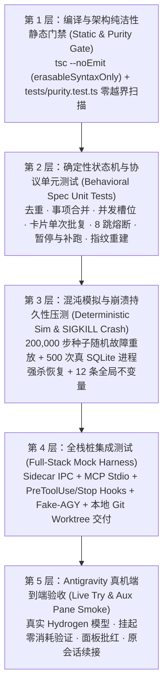

# 06. 全链路测试策略、确定性模拟与验收标准（Testing & Acceptance）

## 1. 测试设计核心原则

继承并强化原版 `agent-autoloop` 最具工程价值的验证理念：
1. **行为规格优先，不为迁就实现改预期**：每一条单元测试都对应一个真实的用户可见行为或历史踩坑事故（如：重复投递不跑两遍、回执写错不重做业务、停止中的失败不重排、已接上会话的中断不换新会话重做）。
2. **每个测试文件首行写明「它防哪种故障」**：拒绝测试内部私有函数名或凑行数的脆弱快照测试。
3. **测试分层零外部副作用**：日常测试与 CI 测试一律使用临时隔离目录（`mkdtempSync` 作为 `AUTOLOOP_HOME`）、显式注入的虚拟时钟 `now` 与本地 `fake-agy` 进程，**绝不消耗真实模型 Token、绝不弹真实系统桌面通知、绝不污染用户 `~/.gemini` 配置**。

---

## 2. 五层验证金字塔全景



---

## 3. 各层必测场景矩阵（Test Specification Matrix）

### 第 1 层：静态类型与纯洁性门禁
| 测试项 | 覆盖文件 | 通过判定标准 |
| :--- | :--- | :--- |
| TypeScript 严格模式与可擦除语法检查 | 全仓 `.ts` | `npm run typecheck` 退出码为 `0` |
| 内核纯洁性扫描 | `tests/purity.test.ts` | `kernel/` 无时钟、随机数、网络、环境变量及具体模型/宿主字符串；`protocol/` 零外部依赖 |
| 前端 XSS 零风险扫描 | `tests/ui-dom-safety.test.ts` | `sidecars/hub/web/` 零未消毒 `innerHTML` / `outerHTML` / `document.write`；注入 `` 卡片标题仅渲染为纯文本 |

### 第 2 层：协议、内核状态机与安全隔离单元测试
| 测试场景域 | 关键必测用例 | 对应测试文件 |
| :--- | :--- | :--- |
| **指令数据分离与防注入** | 1. 事件 `summary`/`detail` 含多行伪造指令或未闭合代码块围栏，确认主提示词 0 字节包含该文本；<br/>2. 事件夹带 `cwd`、`access`、`model` 字段直接抛 `InputError` 拒收；<br/>3. 非法 `subject`（如以 `-` 或 `/` 打头或含空格）或非 ASCII `link` 直接拒收。 | `tests/protocol.test.ts`<br/>`tests/security-isolation.test.ts` |
| **回执解析与无损纠错** | 1. 正常解析五种回执字段与首行三种状态；<br/>2. 代码块未单独占行闭合、JSON 语法错误、误写为 ```` ```json ```` 回执时准确返回 `problem` 并保留首行结论；<br/>3. 业务输出中的普通示例 JSON 代码块不被误判为回执报错。 | `tests/receipt.test.ts` |
| **去重、排队合并与三级并发** | 1. 同一 `source + id` 重复发送只记一次、返回 `duplicate: true`；<br/>2. 同一事项（`rule + subject`）一轮 `claimed` 期间连续到达 5 条新事件，队列中合并为 **唯一** 下一轮；<br/>3. `group.parallel`、`rule.maxActive`、`agent.maxActive` 与 Worker `capacity` 四道并发阀门同时准确生效。 | `tests/decide-routing.test.ts` |
| **会话续接与异常恢复** | 1. `ask` 被回答或 `later` 到期后，下一轮自动携带提问/约定时保存的 `conversationId`；<br/>2. 上一轮被用户 `stop` 取消或更换了目标模型时，强制开启新会话不沿用旧会话；<br/>3. 两个并发轮次绝不同时打开同一个仍在运行或 `unknown` 的 `conversationId`；<br/>4. 失败退避重试时，期间该事项新排队的事件自动并入重试轮次一起处理，连续 10 次失败自动 `cancelled` 并推告警卡。 | `tests/decide-lifecycle.test.ts` |
| **卡片幂等与结案互斥** | 1. 同事项同 `key` 已有 `open` 卡片时重复 `ask` 不发第二张卡；<br/>2. 同一张提问卡连点两次不同选项，仅第一次生效，第二次抛冲突或忽略；<br/>3. `fyi: true` 通知创建即 `closed`，不进入后续轮次 `open` 上下文；<br/>4. 回执 `resolve` 只能关闭同来源同组且领活前已存在的卡片，越界卡片记入 `rejected` 且不影响本轮其他回执生效。 | `tests/decide-lifecycle.test.ts` |
| **8 跳熔断与暂停补跑** | 1. 衍生事件经过 `ask` 人工问答与 `later` 复查后 `hops` 持续累加不归零，第 9 跳（`hops = 9 > 8`）只入账不派单并推单张熔断通知；<br/>2. `pause` 期间定时规则跳过不积压，事件规则记入 `paused` 不入队；`resume` 准确返回跳过事件清单；`replay` 按 `since` 补跑且重复执行 `replay` 不会把同一事件补跑第二次。 | `tests/hops-breaker.test.ts`<br/>`tests/cron-due.test.ts` |
| **单事务账本与零迁移重建** | 更改 `SCHEMA_FINGERPRINT` 或删空投影表后重启 `store`，从 `facts` 全量重放后的每张表记录、序列号与自增高水位与崩溃前一模一样。 | `tests/store-rebuild.test.ts` |

### 第 3 层：20 万步确定性模拟与 `SIGKILL` 崩溃压测
| 压测脚本 | 执行参数与规模 | 验收红线 |
| :--- | :--- | :--- |
| **快速随机模拟（每次提交必跑）** | `node sim/random.ts 24301 20000` | 2 万步内覆盖乱序、重放、超时、取消、暂停补跑，12 条不变量 **0 违背**，耗时 `< 5s` |
| **深度随机模拟（里程碑准出必跑）** | `node sim/random.ts 24301 200000` | 20 万步全状态空间探索，12 条不变量 **0 违背**；任意失败可通过同一种子毫秒级复现 |
| **真 SQLite 强杀恢复压测** | `node sim/crash.ts 500 12648430` | 500 轮真实子进程随机时刻 `SIGKILL` 强杀重启，已确认事实 **0 丢失**、投影重放 **100% 一致** |

### 第 4 层：Antigravity 运行时桩集成测试
1. **生命周期硬钩子联调（`tests/supervisor-and-hooks.test.ts`）**：
   - 构造真实 stdin JSON 喂给 `hooks/pre-tool-guard.mjs`，验证：普通无环境变量会话返回 `allow`；`access: "read"` 会话调用 `edit_file` 返回 `deny`；`access: "edit"` 会话调用命中 `askFirst` 的 `rm -rf` 返回 `deny`；当 `guard.json` 中已包含对应获批决定后放行。
   - 构造含残缺 ```` ```agent-autoloop ```` 代码块的临时 `transcript.jsonl` 喂给 `hooks/stop-receipt-check.mjs`，验证返回 `{"decision":"continue"}` 且第 3 次连续残缺时自动放行交由 Worker 兜底，绝不卡死回合。
2. **MCP 自批防护测试（`tests/mcp-server.test.ts`）**：
   - 正常客户端环境调用 `tools/list` 能拿到完整 `autoloop_answer` / `autoloop_stop` 等管理方法；
   - 注入 `AUTOLOOP_RUN_ID=1` 模拟受控业务子代理调用 `tools/list` 与 `tools/call`，验证 `autoloop_answer` 被隐藏且直接强行调用返回权限拒绝错误。
3. **本地 Git 异构审查交付测试（`tests/delivery-pipeline.test.ts`）**：
   - 创建临时 Git 仓库（含 `main` 与 `feat/demo` 分支），验证：
     - 主工作区如果有未提交修改，完全不受后台 Worktree 检查与快照审查干扰；
     - 审查器首轮报出 1 个 Bug 时拒绝合并并登记账本；同一 Commit SHA 二次触发不会重跑审查；推入修复提交后二次审查通过并自动合入 `main`。

---

## 4. 第 5 层：Antigravity 真机端到端验收手册（Final Acceptance Checklist）

全部代码合入 `main` 并通过前四层自动化测试后，在当前 Antigravity 客户端按以下 6 步完成最终真机验收：

1. **挂载插件**：运行 `./scripts/install-local-plugin.sh`，在聊天中点击 `[autoloop](customization://autoloop)` 确认插件处于已启用状态，且 `autoloop_hub` MCP 与右侧辅助面板已自动就绪。
2. **打开批奏折工作台**：点击 `[Autoloop 工作台](sidecar://autoloop/hub/)` 在右侧辅助面板展开 Web UI，切换 Antigravity 深色/浅色主题，确认面板配色自适应、连接状态显示在线、空闲内存 `< 80 MB`。
3. **执行一键试跑（`autoloop try`）**：
   - 触发试跑事件，观察右侧面板实时出现运行中轮次（模型显示为 `gemini-4-hydrogen-high`）；
   - 数秒后轮次结束，右侧面板弹出 **「【等你决定】试跑：选一个颜色」** 批奏折卡片（带「票拟推荐」标记）；
   - **关键挂起核验**：在终端运行 `ps aux | grep agy`，确认等待你点击期间**没有任何后台 `agy -p` 业务子进程驻留**（100% 挂起零消耗！）；
4. **一键批红与原会话续接**：
   - 在右侧辅助面板直接点击第二个选项按钮（如「青翠绿」）；
   - 观察卡片状态瞬间变为「已批复 · 续办中」，Hydrogen 通过 `--conversation <原会话ID>` 秒级唤醒，读取刚才的上下文后输出「你选了青翠绿，试跑圆满通过」，卡片自动归档为已完成并展示最终结论。
5. **因果溯源核验（`why`）**：
   - 在右侧面板点开刚才那一轮的 `why` 详情（或在聊天窗对主代理说：「用 autoloop 工具查一下刚才试跑那轮的来龙去脉和 Token 消耗」），核对规则版本、触发事件、回答记录、会话 ID 与增量 Token 数据完整无误。
6. **硬护栏实战抽检**：
   - 触发一条带 `askFirst: ["删除文件"]` 的测试规则，观察当 Hydrogen 尝试运行 `rm` 命令时被 `PreToolUse` 钩子当场拦截，并乖乖转为在末尾提交一张 `ask` 批奏折卡片请示用户。

以上 6 步全部一次跑通，即宣告 **Antigravity-Autoloop V1.0 全内生工作台** 正式达到生产可用标准！
