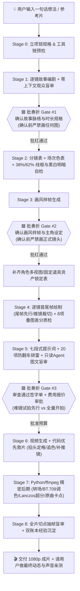

# 07 — 从想法到成片：AI 视频低抽卡率全流程标准作业规范（SOP）

> **方法论来源与融合底座**：深度拆解并重构自 [@EianLu《Claude code/Codex+Seedance AI视频：从一个想法到成片的全流程》](https://x.com/EianLu/status/2118317430665613741)，结合 **Antigravity-Autoloop** 原生「票拟—批红」事件状态机、`PreToolUse` 硬护栏、异构零上下文盲审机制以及本机多通道音视频工具链（`ffmpeg` + `Python` + 程序化字幕包装层）制定。
>
> **核心使命**：当你只输入一句话创意或粗略剧情时，让系统按工业级制片纪律自动运转——**用尽量少的钱、尽量低的抽卡率，稳定做出一条逻辑自洽、构图讲究、节奏在线的成片**。

---

## 一、底层第一性原理：为什么这套流程能把抽卡率压到最低？

大多数人做 AI 视频之所以陷入「无限抽卡、越改越崩、预算烧穿」，根本原因在于**把本该在剧本、分镜、静态设定图阶段锁死的变量，全部甩给了按秒计费的视频生成模型去盲猜**。

本流程建立在三条不可违背的工程铁律之上：

### 1. 错误前置拦截漏斗（Cost-Gated Funnel）

> **「把错误挡在花钱之前：文字里能发现的错，绝不留到图上；图上能发现的错，绝不留到视频上；能用代码修好的瑕疵，绝不花钱重拍视频。」**

| 阶段                                           | 修改单价           | 允许解决的问题                                                                            | 严禁遗留到下一层的问题                                         |
| :--------------------------------------------- | :----------------- | :---------------------------------------------------------------------------------------- | :------------------------------------------------------------- |
| **文字层（故事 / 分镜 / 七段式提示词）**       | ≈ ¥0               | 现实逻辑漏洞、开头平淡、多人同秒机械动作、AI 难拍动作、左右方向歧义                       | 故事说不清主旨、镜头死板无运动、写无效否定句（「不要出水」）   |
| **图像层（画风样帧 / 角色设定 / 首尾帧）**     | 极低               | 构图比例（38%/62%）、黑白明暗分离度、固定道具方位、首尾帧背景对齐                         | 首帧缺后续动作道具、首尾帧墙色/杯子大小漂移、画幅尺寸不一      |
| **视频层（单镜生成，难镜先行）**               | **高（按秒计费）** | 仅负责将已锁死的首帧平滑演进至尾帧（1～2 个主动作）                                       | 靠视频模型自己画屏幕文字、自己脑补转场切镜、一次塞三个以上动作 |
| **代码层（`ffmpeg` / `Python` / 程序化包装）** | ¥0（确定性）       | 掐除首尾坏帧、补微推镜、追首帧色彩、BT.601→BT.709、Lanczos 超分、原曲拍点对齐、精确字幕卡 | 把可以裁切/定格/调色救回来的好镜头直接丢弃重抽                 |

### 2. 「零上下文盲审」消除主导演脑补盲区（Zero-Context Blind Audit）

主制作 Agent 与你讨论过多轮后会产生严重的**上下文脑补偏差**——它以为写清楚了，但第一次看的观众（或无记忆的视频生成模型）根本看不懂。
因此，在**故事定稿、首尾帧完稿、提交视频 API 扣费前、全片粗剪完成**四个节点，**必须**拉起一个**全新的无记忆只读子代理（Blind Auditor）**，**只喂当前产物文件，绝不喂前文聊天结论**，强制它先复述看懂了什么、再逐项挑错，未明确写出「通过」严禁放行。

### 3. 「四线程角色制衡」与 Antigravity-Autoloop 原生架构 1:1 升级映射

EianLu 原文采用「1 个总导演 + 3 个子 Agent（审核 / 监督 / 代理）」四线程协作；迁移至 **Antigravity-Autoloop** 后，我们将原本依赖 Prompt 自觉遵守的软约定全面升级为系统级硬机制：

| 原文角色 / 工具             | 原文职责                                     | Antigravity-Autoloop 原生映射与增强实现                                                                                                                |
| :-------------------------- | :------------------------------------------- | :----------------------------------------------------------------------------------------------------------------------------------------------------- |
| **你（出品人 / 厂长）**     | 选方向、确认画风、批预算、看动态、听声音     | 只在右侧 **批奏折工作台**（`sidecar://autoloop/hub/`）处理 **3 张关键 `ask` 审批卡** + 最终成片动态/听感终验；等待期后台 **0 进程驻留、0 Token 消耗**  |
| **主做（总导演 Claude）**   | 写故事分镜、写全部提示词、调工具、写后期代码 | **`carbon-architect`（`gemini-4-carbon-high`）** 挂载 `recipe-ai-video-studio` Skill，开启 `resume: true` 全程保持单片导演连贯记忆                     |
| **审核（只读挑刺员）**      | 零背景挑错，只读不改文件，花钱前必签「通过」 | **独立只读盲审子代理（`gemini-4-hydrogen-xhigh` / `research`，`access: "read"`）**：每次全新会话不带历史偏见，逐像素核对图文一致性                     |
| **监督（防遗忘督察）**      | 把用户提过的所有要求列成清单，每步核查防漏   | **单片规格锁 `spec.json` + 全局 `.autoloop/decisions.md`（圣旨账本）**：每阶段准出前自动逐条勾稽用户硬约束                                             |
| **代理（偏好与预算管家）**  | 按历史偏好做战术决定，超预算或越界立即停机   | **`.autoloop/declined.md`（避坑账本）+ `PreToolUse` 硬护栏（`askFirst`）**：战术细节按账本自决；触碰真实视频生成扣费前强制弹卡报价审批                 |
| **画师（Codex 生图）**      | 画设定图、样帧、逐镜首尾帧                   | **可插拔生图通道**：内置 `image-generator` 子代理 / 本地 Z-Image / `codex` 生图 + `video-qa-tools.py` 强制尺寸裁切与叠图差分                           |
| **动画师（Seedance）**      | 把首尾帧变成数秒视频片段                     | **双模视频生成通道**：① 云端火山方舟 Seedance（`2-0-mini` 常规镜 / `2-5` 复杂镜）；② 本地 H3 视频产线（Ref2VA / FL2VA 零边际 API 费）                  |
| **后期与包装（ffmpeg+Py）** | 拼接、转场、调色、放大、卡点                 | **`ffmpeg` + `Python` + `video-qa-tools.py`**（色彩空间校准、Lanczos 超分、拍点测算）+ **Remotion（`video-shotcraft`）承载全部精确屏幕文字与字幕动效** |

---

## 二、标准项目目录与「永不覆盖」文件契约

每启动一个新视频想法，总导演必须在工作区建立独立隔离目录 `video-projects/<YYYYMMDD-slug>/`。**任何修改一律递增版本号（`_v1`, `_v2`...），严禁覆盖或删除任何旧图与旧视频片段**（重拍的新片段未必优于旧片段，保留全部素材供后期混剪择优）：

```text
video-projects/<YYYYMMDD-slug>/
├── spec.json                    # 立项五要素锁：片长、画幅、预算上限、音乐/BPM、生图与视频通道、用户硬要求清单
├── 01-story/
│   ├── story_v1.md              # 逐镜头故事与三段式反应设计
│   └── audit_story_v1.md        # 零上下文观众盲审记录（含复述测试与通过结论）
├── 02-storyboard/
│   ├── storyboard_v1.json       # 结构化分镜表（时间、生成秒数、景别、机位、运镜、主运动源、转场）
│   ├── palette_v1.json          # 场次配色表（主色、背景色、强调色、明度对比规划）
│   ├── wireframe_grid_v1.png    # 标出 38% / 62% 黄金构图线与主体落位的色块草图总表
│   └── wireframe_gray_v1.png    # 黑白灰度转换图（检验人物与背景明暗分离度）
├── 03-assets/
│   ├── style_sample_v1.png      # 画风定调样帧（人类 Gate 2 确认项）
│   ├── asset_lock.json          # 资产锁定表（角色外貌、服装、固定特征精确部位如「左手小臂外侧纹身」、固定道具）
│   └── char_<name>_sheet_v1.png # 角色正面/侧面/核心表情设定图 & 关键道具设定图
├── 04-frames/
│   ├── s01_last_v1.png          # 镜头 01 尾帧（元素最多帧先行绘制）
│   ├── s01_first_v1.png         # 镜头 01 首帧（由尾帧局部派生或裁切对齐）
│   └── qa/
│       ├── s01_diff_v1.png      # 首尾帧像素差分叠图（排查背景变色与静态道具缩放漂移）
│       └── s01_mobile_v1.png    # 手机屏小尺寸可读性预览图
├── 05-prompts/
│   ├── s01_prompt_v1.txt        # 严格七段式视频生成提示词
│   ├── audit_pre_submit_v1.md   # 花钱前独立只读 Agent 逐字逐像素盲审签字单
│   └── quote_v1.json            # 分镜头模型档位、秒数与预估费用明细单（人类 Gate 3 确认项）
├── 06-takes/
│   ├── s01_take_v1.mp4          # 原始生成视频片段（永不覆盖删除！）
│   └── s01_salvaged_v1.mp4      # 经代码掐头/定格/追色/补推镜修复后的可用片段
├── 07-edit/
│   ├── build_edit.py            # 可复现的 Python + ffmpeg 自动化后期合成脚本
│   ├── rough_cut_v1.mp4         # 粗剪预览片
│   └── master_1080p_v1.mp4      # BT.709 + Lanczos 1080p 调色转场成片
└── 08-review/
    ├── frames_check/            # 每镜抽帧 + 每个切点前后各 3 帧全分辨率截图
    ├── audit_final_v1.md        # 全片零上下文观众盲审报告（硬伤 vs 小问题 + 待人类亲测项）
    └── retrospective.md         # 本片沉淀经验（同步回写 .autoloop/decisions.md & declined.md）
```

---

## 三、从一句话想法到最终成片：九阶段标准执行流水线

全流程共 **9 个阶段（Stage 0 ～ Stage 8）**，其中人类只需要介入 **3 次「批奏折」拍板 + 1 次最终视听验收**，其余全部由多模型与本地代码自动闭环：



---

### Stage 0：立项锁规格与本机工具链预检（Intake & Preflight）

- **自动动作**：
  1. 读取工作区 `.autoloop/decisions.md` 与 `declined.md`，加载用户既有画风/画幅/节奏偏好（例如竖屏 9:16 或横屏 16:9、是否不要 BGM、字幕走程序化包装层等）。
  2. 检查本机环境：`ffmpeg`、`ffprobe`、`python3`、生图通道（内置 `image-generator` / 本地 Z-Image / `codex`）以及视频生成通道（环境变量 `ARK_API_KEY` 火山方舟 Seedance 或本地 H3 视频队列，**严禁在任何日志或卡片中打印密钥明文**）。
  3. 若用户输入的想法尚未指明核心五要素（**目标片长、画幅比例、总预算上限、配乐/旁白需求、画风倾向**），合并在 **Gate #1** 与故事初稿一并附默认推荐值请用户拍板，避免碎问打扰。

---

### Stage 1：从想法到完整逐镜故事 + 零上下文观众盲审

- **五大编剧硬标准（写初稿时逐条自检）**：
  1. **符合现实物理与行为逻辑**：每个转折追问四句——_为什么会这样？东西从哪来？够得着吗？现实里真会这样吗？_（超现实设定除外，但内部规则仍须自洽）。
  2. **一句话说清核心表达**：先在文档第一行写出这句话和全片最妙的设计点；写不出来说明故事平淡，必须推翻重磨。
  3. **黄金前 3 秒强钩子**：最抓眼球、最具反差或悬念的画面必须前置到第 `0～3` 秒，明确标出第几秒出现什么。
  4. **旁人反应三段式与错峰铁律**：每个包袱或转折按 **「问题出现 → 主角如何应对 → 旁人真实反应」** 三段展开。**严禁多人同一秒做同一个动作**（一眼假 AI 味！必须写明先后错峰与生理本能细节，如吃惊时肩膀微缩、半步后仰）。
  5. **AI 可拍性前置避障（源头降抽卡率）**：
     - **结构首选「片段式（Montage / Episodic）」**：镜头间无需严丝合缝接连续动作戏，容错率最高；非用户强制要求慎用长连贯动作戏。
     - **写剧本阶段直接绕开 9 大 AI 高危动作**：① 多人肢体交叉遮挡；② 手指精细拿捏极小物件；③ **画面内直接生成精确文字/招牌/UI**（一律留白交后期程序化叠加）；④ 镜子与复杂水面精确倒影；⑤ 左右极度不对称的复杂服装配饰；⑥ 单镜头内剧烈变光；⑦ 单镜头内一人连续做 3 个以上动作；⑧ 纯大俯拍看不到脸与肢体朝向；⑨ 同框活跃配角过多。
     - **若有对白/旁白**：按中文自然语速 `4～4.5 字/秒` + 停顿反应余量核算台词容量，绝不把 8 秒的词硬塞进 4 秒镜头。
- **盲审门禁（Audit 1）**：
  - 启动全新只读子代理，**仅传入 `story_v1.md`**，要求先写出它看懂的故事梗概，再按上述 6 项挑刺。若盲审 Agent 看错剧情或挑出硬伤，主导演修改出 `story_v2.md` 直至盲审输出「通过」。
- **🟥 批奏折 Gate #1**：向用户呈交《一句话主旨 + 逐镜故事定稿 + 五要素规格确认卡》（附票拟推荐选项），**退出进程零消耗等待；未经用户确认故事，严禁画任何一张图！**

---

### Stage 2：分镜设计、独立色表与黄金构图线框自检

- **若有参考片**：先用 `ffmpeg` 抽帧测量参考片的景别切换节奏、机位高度、主体进出画比例与色调分布，数字化复刻其镜头骨架。
- **无参考片时严格执行六条分镜铁律**：
  1. **每镜换机位角度**：**全片平视正面镜头最多不超过 2 次**！其余强制交替使用俯拍、仰拍、背后跟拍、过肩镜头（OTS）、前景遮挡窥视（透过门缝/杯沿/枝叶拍）。
  2. **拒绝「死画面」**：绝大多数镜头必须设计明确的**主体进画或出画轨迹**（写清从画面左侧还是右侧进出）；若角色设定必须静坐不动，必须安排环境动态元素（飘落的纸张、窗外掠过的光影、身后走过的路人）；固定机位尤其要靠纵深走位（由远走近或由近走远）破除呆板。
  3. **景别强制交替**：严禁连续多个镜头使用相同景别（如连拍三个全身），必须在远景、全景、中景、近景、面部/手部特写之间有节奏地呼吸切换。
  4. **每镜写死唯一主运动源**：动笔前回答「这一镜到底是什么在动？」——摄影机运动、焦点转移（Rack Focus）、光线变化、前景飘物、或人物关键微动作（如指尖发抖），至少有一样，且做到动静留白对比，忌全片乱晃。
  5. **运镜必有叙事理由（仅限三大动机）**：① 跟随运动主体（信飞到哪跟到哪）；② 情绪递进缓慢推近给特写；③ 悬念揭晓从局部特写缓慢拉远展现全貌。无理由不乱动机位，不动就明确写死「固定机位，不推不拉不摇不切镜」。
  6. **任意一秒截图皆成构图（38% / 62% 黄金分割）**：人物头部或视觉焦点落在画面水平约 **`38%` 或 `62%`** 处，严禁呆板居中。生成秒数按片中实际所需时长向上取整并**多留 `0.5～1.0 秒` 剪辑余量**（单镜不超过模型上限，通常 5～10 秒最稳）。
- **独立配色表与程序化黑白明度自检**：
  1. 在画第一张图前单独输出 `palette_v1.json`，列明每一场的主色调、背景色、人物服装色与受保护强调色。
  2. 调用脚本绘制标有 `38% / 62%` 基准线的色块构图总表 `wireframe_grid_v1.png`，并调用 `video-qa-tools.py grayscale` 转成纯黑白图 `wireframe_gray_v1.png` 检查：**若转成黑白后人物主体与背景糊成一片区分不开，说明明度反差不足，必须立即重调配色！**

---

### Stage 3：画风样帧确认与角色/道具资产锁定（Style & Asset Lock）

- **Step 3A（画风定调）**：主导演编写高精度画风提示词（优先结合用户提供的参考图），调用生图工具产出 1～2 张代表性画风样帧 `style_sample_v1.png`。
- **🟥 批奏折 Gate #2**：将 `style_sample_v1.png` 与分镜构图总表呈交用户确认画风与主角气质。**未经用户确认画风，严禁开画正式分镜首尾帧！**
- **Step 3B（资产锁定表与多视图设定图）**：
  - 为每位核心角色生成包含**正面、侧面、核心表情**的设定图，为高频关键道具生成独立设定图；
  - 写入 `asset_lock.json`：**人物身上所有不对称或固定特征必须用绝对方位写死**（例如「红色创可贴固定在左脸颧骨下方」「手表戴在左手腕」，否则后续每张图都会左右乱跳）。**`asset_lock.json` 为空时严禁进入 Stage 4！**

---

### Stage 4：逐镜首尾帧绘制与 8 项像素级质检（降抽卡核心关卡）

只靠纯文本生成视频极易出现道具凭空消失（雨停了、帽子没了、纹身没了）或空间瞬移；**首尾帧双锚定（First + Last Frame）是锁死物理连续性的最核心手段**。

- **绘制顺序五大实操铁律**：
  1. **先写后画过审**：先写出每镜「首帧画什么、尾帧画什么、中间发生什么」文字稿，经只读审核 Agent 核对无逻辑断层后再调生图工具，绝不盲目消耗生图额度。
  2. **复杂帧（通常为尾帧）先行法**：先画画面元素最全、动作落点最满的那一帧（通常是尾帧），再以它为底图局部修改派生出首帧——从根源保证两张图的摄影机透视、焦距与背景完全锁死！
  3. **同场景同机位复用底图**：同一地点、同一机位的相邻镜头直接在前一镜底图上做局部编辑，绝不从零重抽背景。
  4. **慢推镜头「裁切放大法」**：若镜头设定为「缓慢推近」，**尾帧直接由首帧按目标构图裁切放大生成**！切忌让生图模型画两张构图几乎一样的图（否则视频模型会判定机位静止，完全没有推镜效果）。
  5. **局部重绘贴回原图 & 尺寸像素强制对齐**：由于局部改图模型往往会重编码整张图导致墙面轻微变色，只改局部时用 Python 将修改区域羽化贴回原图未动背景；最终统一用 `ffmpeg` / Python 校验所有首尾帧严格满足目标分辨率比例（如精确 `1920×1080` 或 `1080×1920`），首尾帧宽高像素必须 100% 一致。

- **8 项首尾帧必查清单（配 `video-qa-tools.py` 自动辅助）**：
  1. **动作道具首帧必现**：镜中要拿杯子，首帧里杯子必须在桌面上可见，否则视频里会凭空变魔术冒出来。
  2. **反应角色首帧预埋**：单镜一镜到底无法中途切机位，若有旁人反应，首帧就必须安排好前景动作人与后景朝向镜头的反应人。
  3. **多人拒绝同姿势**：同框多人起始姿态必须错开，防止模型驱动全员同步做广播体操。
  4. **预留运动空间与头顶留白**：物体飘落路径、人物走入位置必须提前留空。
  5. **全局物理风向统一**：围巾往画面左飘，窗帘和树叶绝不能往右飘。
  6. **缩至手机屏尺寸可读性检查**（`video-qa-tools.py mobile-preview`）：缩小到手机宽度检查远景主体是否小到看不清。
  7. **100% 放大查脏点**：排查多出来的水壶、多出的手指或诡异细线。
  8. **首尾帧叠图差分检查**（`video-qa-tools.py diff-frames`）：将首帧与尾帧像素相减叠图——**凡是不该动的背景墙色、桌角、杯子尺寸若出现错位或色差（否则视频里墙壁会呼吸变色、杯子会慢慢膨胀），立即修图对齐！**

---

### Stage 5：七段式视频提示词、20 项防翻车排雷与花钱前盲审

出了画面崩坏先怀疑提示词没写准。所有镜头统一采用以下**强制七段式模板**（`05-prompts/sXX_prompt_v1.txt`）：

```text
【画风】[一句话精确定义画风、笔触/光影质感、颗粒度]。整段的画风、色彩、人物设计与首帧和尾帧完全一致。
【镜头】整段 [X] 秒，[景别]，[机位]，[运镜；固定机位就写死“固定机位，不推不拉不摇，不切镜”]。
【构图与配色】[主体与关键道具在画面左/右/前/后的精确位置，主光与墙面背景颜色，严格与首帧一致]。
【人物】[逐一写死每个出场角色的长相、服装、固定配饰位置，与设定表逐字对齐]。
【逐秒】
0–0.2 秒：画面完全静止，与首帧一模一样。
[中段按时间片写：谁先做什么、谁后做什么，表情如何变化，两只手分别放在哪，朝画面左边还是右边移动；每镜只安排 1～2 个主动作]
最后 0.3 秒：所有动作完全停稳，画面与尾帧完全一致。
【声音】只有 [画面中看得见发声源的具体环境音效]。人物不说话（或按对白轨严格对齐）。
【约束】画面里从头到尾只有首帧出现的这几个人和这些物品，人物五官与身形全程保持一致，一镜到底。画面干净纯粹，无文字、无字幕、无水印。
```

#### 附：模型 20 大高频翻车症状与正面写法速查表（写词与盲审必查）

| #   | 模型高频翻车症状                             | 根治写法与工程对策                                                                                           |
| :-- | :------------------------------------------- | :----------------------------------------------------------------------------------------------------------- |
| 1   | 一群人同一秒机械同步动作                     | 首帧错开姿势 + 提示词写死先后时序：「A 先抬头，过 1 秒 B 才转头，C 最后后仰」                                |
| 2   | 本该风吹动的物体变成人伸手去掀               | 写明物理外力原因，并正面写死手部状态：「双手全程握住车把，紧贴身侧未抬起」                                   |
| 3   | 云朵、月亮、植物自己长出五官笑脸             | 禁用「卡通云」等拟人词，改写材质物理描述：「蓬松的灰白色积云，仅有棉絮状纹理与明暗阴影，缓慢向画面右侧平移」 |
| 4   | 人物朝相反方向走                             | 禁用「向前/向门外走」等相对词，一律按画框绝对方向写：「朝画面左侧迈步，跨过画面左边缘的木门」                |
| 5   | 空间指代歧义（写「窗后老人」结果车窗冒出人） | 写死画面坐标 + 封死歧义位：「画面左上角石屋二楼木窗内有一位老人；前景汽车驾驶座全程空无一人」                |
| 6   | 道具数量越拍越多                             | 直接写死精确数量：「右手只拿一封黄色信封，挎包内其余全是白色信封」                                           |
| 7   | 写否定句「壶嘴不要出水」结果疯狂喷水         | **删掉否定词，全改肯定态描述**：「茶壶稳置桌面，壶嘴全程保持干燥静止」                                       |
| 8   | 模型强行触发道具刻板联想（见壶就倒水）       | 非必要动作道具直接从动态镜头的首尾帧中移除                                                                   |
| 9   | 物品凭空冒出                                 | 严守首帧铁律：只准操作首帧已经清晰画出来的物品                                                               |
| 10  | 道具瞬间移动或飞走                           | 拆解连续物理轨迹：「草帽顺着后脑勺向后滑落，右手顺势接住并重新扣回发顶」                                     |
| 11  | 雨丝、帽子、纹身拍到一半消失                 | 首帧与尾帧**两张图都必须清晰画上**                                                                           |
| 12  | 闪电等特效画成廉价写实贴图                   | 改写受控光效：「远处云层内部透出一下柔和白光」，并配合后期裁掉起势生硬帧                                     |
| 13  | 单镜塞太多动作导致肢体扭曲崩坏               | **每镜严格限制 1～2 个主动作**，复杂调度拆成两个独立镜头                                                     |
| 14  | 生成动作节奏与预想秒数有偏差                 | 生成秒数多留 0.5～1 秒余量，进 Stage 7 用代码切片变速精准对齐音乐节拍                                        |
| 15  | 慢推镜头推得不够明显                         | 不必重抽，进 Stage 7 用 `ffmpeg` 动态缩放补足推镜幅度                                                        |
| 16  | 角色没台词但嘴巴自己乱动                     | 提示词写明「双唇自然闭合不说话」；若仍微动，后期用代码局部修补                                               |
| 17  | Seedance 2.5 写了无音乐仍混入背景乐          | 弃用原片混入的脏音轨，Stage 7 用代码重新铺纯净环境音效与配乐                                                 |
| 18  | Seedance 2.5 结尾几帧突然硬跳到尾帧          | Stage 6/7 找到跳变前最后一张干净帧，后面几帧直接代码定格（Freeze Frame）或提前切走                           |
| 19  | Seedance 2.5 第一帧异常过锐闪烁              | Stage 7 拼接前直接用代码裁掉第 0 帧                                                                          |
| 20  | Seedance 2.0 mini 越往后画面越暗越冷         | Stage 7 每段视频以它自己的首帧为色彩基准，用代码把后半段亮度与色温拉回一致                                   |

- **花钱前盲审门禁（Audit 2）**：
  - 启动全新只读盲审子代理，喂入 `[提示词 + 首帧 + 尾帧 + 设定图 + 分镜表 + 配色表]`，逐字放大核对左右、数量、衣服、机位比例；全部镜头必须拿到明确「**通过**」签字单 `audit_pre_submit_v1.md`。
- **🟥 批奏折 Gate #3（报价与试拍放行卡）**：
  - 汇总通过盲审的镜头清单、各自选用的模型档位（常规镜头优先选高性价比档如 `720p` + `Seedance 2.0 mini` 或本地 H3；高难复杂调度镜头才上旗舰档）与预估总花费；
  - 默认**票拟推荐：「先试拍全片最难的 1～2 个镜头验证效果，跑通后再批量提交剩余镜头」**；获批后方可执行扣费生成！

---

### Stage 6：视频生成与「代码优先、三不重拍」救片法则

- **省钱增效执行准则**：
  1. **720p 生成 + 后期超分**：默认以 `720p` 生成省下大笔按秒费用，在 Stage 7 用 `Lanczos` 无损算法放大至 `1080p`。
  2. **不拍废测试片，直拍最难正式镜**：直接挑全片调度最难的 1～2 个正式镜头开拍——成了直接入片净赚，不通立刻调方案止损。
  3. **额度熔断保护**：若 API 返回余额不足或本地算力离线，**严禁自动充值或死循环重试**，立即停机将已生成片段粗剪输出并通知用户。
- **发现瑕疵时的三级急救阶梯（严禁上来就重抽烧钱！）**：
  1. **第一级：能剪掉吗？** 若瑕疵仅在开头第 1 帧（过锐）或结尾最后几帧（跳尾帧），直接用 `ffmpeg` 掐头去尾或定格干净帧即可完美解决。
  2. **第二级：能用代码修吗？** 推镜不够猛用 `zoompan`/动态裁切补推；后段变暗变冷按首帧均值做线性色彩追平；局部小穿帮用遮罩贴片修复。
  3. **第三级：确需重拍时，必改输入 + 只拍单镜 + 留存旧档**：原封不动重抽大概率犯同样的错，重拍前**必须先修正提示词或首尾帧图片**，仅重拍这一镜，存为 `sXX_take_v2.mp4`，旧版 `v1` 严禁删除。

---

### Stage 7：全代码化精密后期合成（Programmatic Post-Production）

严禁靠手拖粗放拼接，全部编写可复现的 `07-edit/build_edit.py` 调用 `ffmpeg`（及可选 Remotion `video-shotcraft`）完成专业级母带处理：

1. **有动机的遮挡/动态模糊转场**：按分镜表设计的转场方式衔接；运动衔接处切分 `8～16` 份子帧混合模拟 `180°` 半帧快门运动模糊，消除生硬跳切。
2. **克制高级的分场调色**：按故事场次分段调色——**只微调饱和度（Saturation）与明度（Luminance），严禁乱偏色相（Hue），重点保护强调色与人物肤色干净**；不加廉价胶片颗粒、柔光滤镜或黑边暗角。
3. **严格的色彩空间管线**：针对 Seedance 等模型导出的 MP4，按 `BT.601` 正确解码色彩矩阵，中间处理采用无损/高码率帧格式，最终成片统一显式写入 **`BT.709`** 色彩元数据标签，杜绝播放器发灰偏色。
4. **720p → 1080p Lanczos 超分微锐化**：使用 `scale=1920:1080:flags=lanczos`（竖屏为 `1080:1920`）配合极轻量 `unsharp` 边缘锐化；**严禁对整片做 AI 光流插帧**（插帧会彻底破坏动画原有的停顿表演节奏并制造果冻伪影）。
5. **原曲拍点测算与程序化字幕**：
   - 配乐卡点时间戳**只能从原始未剪辑音乐文件上测算**，严禁在二次剪辑过的文件上重测导致累积漂移；
   - 所有片头标题卡、精确屏幕 UI 文字与字幕，一律在后期通过代码或 Remotion（`video-shotcraft`）帧级精确合成。
6. **切点自检**：脚本自动调用 `video-qa-tools.py extract-cuts` 把每个剪辑切点前后各 3 帧导出备查。

---

### Stage 8：全片零上下文观众盲审与双账本经验固化

1. **全片观众盲审（Audit 3）**：
   - 拉起全新只读盲审子代理，**只给成片抽帧（每镜多张全分辨率帧 + 全部切点前后各 3 帧），不给原剧本与任何前置结论**；
   - 盲审报告必须包含：① 它仅凭画面看懂的故事；② 看不懂或跳戏的位置；③ 按 `时间戳 + 帧号` 精确列出的「**硬伤**」（穿帮、多手多物、切点闪帧、颜色骤变、文字错误）与「**小问题**」；④ **诚实边界声明**：明确列出静态抽帧查不到的维度——**连续动态流畅度体感**与**真实声音/配乐情绪听感**。
2. **修复硬伤与最终呈交**：主导演修复全部代码可解的硬伤后，生成最终 `master_1080p.mp4`，发通知/验收卡请人类厂长做最后一遍**眼睛看动态 + 耳朵听声音**终验。
3. **组织免疫力沉淀**：将本片验证成功的画风描述词、色彩参数、新发现的模型脾气自动整理写入 `.autoloop/decisions.md` 与 `.autoloop/declined.md`——**让下一支片子起步即站在上一支片子的肩膀上**。

---

## 四、后续你如何直接驱动这套流水线？

从现在起，当你脑子里冒出一个视频想法时，你只需要给我（或丢进 `.autoloop/inbox/`）非常简短的一段话即可，例如：

```text
我想做一条 30 秒左右的短片：[这里写你的一句话脑洞或粗略情节]
画幅：[16:9 横屏 / 9:16 竖屏，不写就按默认]
风格参考：[比如吉卜力手绘 / 冷调写实生活剧 / 美式粗线条动画，或者贴一张参考图路径]
通道与预算：[比如用 Seedance 预算 ¥30 内，或者走本地免费生成通道]
```

收到后，系统会自动按 **Stage 0 → Stage 8** 启动：

- 自动建好项目目录、写好故事并完成第一轮「零上下文观众盲审」，然后把打磨好的故事递到你面前等你点第一次确认；
- 你全程只需点 **3 次确认（定故事 → 定画风 → 批报价开拍）**，最后直接验收 `1080p` 成片！
